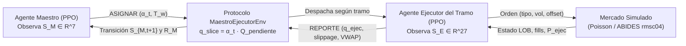

# Metodología: Diseño de la Solución e Implementación del Sistema (Capítulos 4 y 5)

**Autor:** Mauricio Reynoso (MR) — Tarea 4.1.1 (Sprint 8).  
**Nota de ensamblado:** En el plan operativo (`plan-desarrollo-titulo-2.xlsx`), este contenido corresponde al *Capítulo 5: Metodología*. En la guía de ensamblado del Título I (`docs/informe_titulo2_ensamblado_borrador.md`), se distribuye en **Capítulo 4: Diseño de la solución** (Secciones 1 a 4) y **Capítulo 5: Implementación del sistema** (Secciones 5 a 7).

---

# Parte I (Cap. 4): Diseño de la Solución

## 4.1 Formulación del Problema como MDP Jerárquico (CTDE)

El problema de ejecución óptima de una meta-orden institucional de compra de tamaño total $Q_{\text{total}}$ durante una jornada bursátil (09:30 a 16:00 horas) se modela mediante un esquema de **Aprendizaje por Refuerzo Jerárquico (HRL)** con **Entrenamiento Centralizado y Ejecución Descentralizada (CTDE)**. La arquitectura descompone la toma de decisiones en dos niveles temporales acoplados mediante el protocolo `MaestroEjecutorEnv` (`src/envs/maestro_ejecutor_protocol.py`):

1. **Nivel Estratégico — Agente Maestro (MDP de horizonte diario):**  
   Opera en pasos de decisión macroscópicos cada $30$ minutos (hasta $13$ decisiones en una jornada completa). En cada paso $t$, observa el estado macro del inventario y de la sesión, y decide qué fracción del inventario remanente asignar a la siguiente ventana y por cuánto tiempo ejecutarla.
2. **Nivel Táctico — Agentes Ejecutores (MDP de microestructura intradía):**  
   Se definen tres agentes especializados por tramo horario (**Apertura** `09:30–11:30`, **Media jornada** `11:30–14:00` y **Cierre** `14:00–16:00`). Reciben una sub-orden $q_{\text{slice}}$ y una ventana $T_w$ desde el Maestro, operando paso a paso sobre el libro de órdenes límite (LOB) cada minuto hasta agotar la ventana o completar $q_{\text{slice}}$.



---

## 4.2 Espacios de Estado y de Acción

### 4.2.1 Agente Maestro ($S_M$ y $A_M$)

El vector de estado estratégico $S_M \in \mathbb{R}^7$ (`DIM_SM = 7` en `src/models/networks_factory.py`) resume el avance de la ejecución y el contexto de la sesión:

| Índice | Variable | Definición y rango operativo |
|---|---|---|
| 0 | `q_t` | Fracción de inventario remanente $Q_{\text{pendiente}} / Q_{\text{total}} \in [0, 1]$ |
| 1 | `tau_t` | Tiempo transcurrido normalizado desde las 09:30 hasta las 16:00 $\in [0, 1]$ |
| 2 | `n_slices` | Fracción normalizada de decisiones consumidas en la jornada |
| 3 | `volatilidad` | Volatilidad realizada reciente (fija en `0,002` en el sistema base; dinámica en Maestro v2) |
| 4 | `vol_promedio` | Volumen promedio normalizado (fijo en `0,2` en el sistema base; dinámico en Maestro v2) |
| 5 | `OBI_agregado` | Desbalance agregado del libro de órdenes (*Order Book Imbalance*, `0` en base; dinámico en v2) |
| 6 | `sesion` | Indicador de tramo horario: `0,0` apertura `[09:30, 11:00)`, `0,5` media jornada `[11:00, 14:00)`, `1,0` cierre `[14:00, 16:00]` |

* **Espacio de acción $A_M$:** Discreto de cardinalidad $|A_M| = 40$ (`N_ACCIONES_MAESTRO = 40`), resultante del producto cartesiano entre:
  - $10$ fracciones de volumen pendiente: $\alpha \in \{0{,}05;\; 0{,}10;\; \dots;\; 0{,}50\}$.
  - $4$ duraciones de ventana táctica: $T_w \in \{1,\; 5,\; 10,\; 15\}\text{ minutos}$.
  - Dado un índice $a_M \in \{0, \dots, 39\}$, la sub-orden asignada es $q_{\text{slice}} = \alpha \cdot Q_{\text{pendiente}}$.
  - **Regla de barrido al cierre (Desviación 11):** en la evaluación con `--completar-al-cierre`, en la última decisión posible de la jornada se fuerza $\alpha = 1{,}0$ para evitar remanentes artificiales por la restricción $\alpha \le 0{,}50$.

### 4.2.2 Agentes Ejecutores ($S_E$ y $A_E$)

El vector de estado táctico $S_E \in \mathbb{R}^{27}$ (`DIM_SE = 27`, `docs/schemas/SE_schema.json`) captura la microestructura instantánea del LOB:
- **$3$ variables privadas:** inventario restante normalizado de la sub-orden, tiempo restante normalizado en la ventana y spread relativo actual.
- **$20$ variables del libro de órdenes ($10$ bid + $10$ ask):** precios relativos al *mid-price* y volúmenes normalizados de los $5$ mejores niveles de compra y venta.
- **$4$ variables de mercado:** desbalance de volumen en puntas (*OBI*), retorno de corto plazo, volatilidad realizada intraventana y tasa de llegada de órdenes (`tasa_ordenes = 0` en ABIDES, Desviación 14).

* **Espacio de acción $A_E$ (Desviación 2):** Discreto aplanado de cardinalidad $|A_E| = 240$ (`MultiDiscrete([3, 10, 8])` decodificado por `EjecutorActionSpace.decode_flat`):
  - **Tipo de orden ($3$):** mantener/cancelar (`HOLD`), orden límite (`LIMIT_BUY`) u orden a mercado (`MARKET_BUY`).
  - **Nivel de volumen ($10$):** fracción del saldo pendiente de la ventana ($10\%, 20\%, \dots, 100\%$).
  - **Offset de precio ($8$):** nivel relativo en el libro desde el nivel más pasivo (`0`) hasta el cruce agresivo (`7`).

---

## 4.3 Funciones de Recompensa y Factores de Descuento

### 4.3.1 Recompensa del Maestro ($R_M$)

El Maestro recibe recompensa al término de la jornada penalizando tanto el *Implementation Shortfall* (IS) acumulado respecto al precio de llegada $P_{\text{llegada}}$ como el inventario no ejecutado al cierre:

$$R_M = -IS_{\text{total}} - \lambda \cdot \max\bigl(0,\; Q_{\text{pendiente}}\bigr) \cdot P_{\text{mid\_cierre}}$$

donde:
- $IS_{\text{total}} = \sum_{k} (P_{\text{ejec},k} - P_{\text{llegada}}) \cdot q_k$ (en CLP),
- $\lambda = 0{,}02$ (valor final empleado en `sistema_final/maestro/lambda.json`, calibrado por balance de escala en la tarea 2.2.2 para que la penalización por saldo residual domine el incentivo a no operar sin desestabilizar la función de valor),
- Factor de descuento $\gamma_M = 0{,}99$.

### 4.3.2 Recompensa del Ejecutor ($R_E$)

En cada paso táctico $t$ dentro de la ventana, el Ejecutor recibe la recompensa por ejecución relativa al *mid-price* de entrada penalizada por aversión al riesgo de volatilidad:

$$R_{E,t} = \bigl(P_{\text{mid},t} - P_{\text{ejec},t}\bigr) \cdot q_t - \beta \cdot \sigma^2 \cdot q_t$$

donde:
- $\beta = 0{,}0061796$ (calibrado en la tarea 2.2.3 mediante barrido fase 2 en `beta_fase2_*`),
- Factor de descuento $\gamma_E = 1{,}0$ (Desviación 6: con $\gamma_E = 0{,}95$ del Título I, el agente aprendía a postergar compras hasta el último paso; fijar $\gamma_E = 1{,}0$ junto con la penalización por saldo remanente al cierre de la ventana garantiza cumplimiento completo).

---

## 4.4 Arquitectura de Redes Neuronales y Algoritmo PPO

### 4.4.1 Arquitectura Actor-Crítico

Tanto el Maestro (`MasterActorCritic`) como cada Ejecutor (`ExecutorActorCritic`) heredan de `BaseActorCritic` (`src/models/actor_critic.py`), implementado como un perceptrón multicapa con tronco compartido:

$$\text{Tronco compartido:} \quad \mathbf{h} = \text{ReLU}\bigl(W_2 \cdot \text{ReLU}(W_1 \mathbf{s} + \mathbf{b}_1) + \mathbf{b}_2\bigr), \quad W_1 \in \mathbb{R}^{256 \times d_{\text{in}}},\; W_2 \in \mathbb{R}^{256 \times 256}$$

$$\text{Cabeza Actor:} \quad \pi_\theta(a \mid \mathbf{s}) = \text{Softmax}(W_\pi \mathbf{h} + \mathbf{b}_\pi), \qquad \text{Cabeza Crítico:} \quad V_\phi(\mathbf{s}) = W_v \mathbf{h} + b_v$$

### 4.4.2 Optimización PPO (*Proximal Policy Optimization*)

La actualización de parámetros $(\theta, \phi)$ se realiza mediante **PPO-Clip** (`src/training/ppo_trainer.py`) con estimación de ventaja generalizada (**GAE**):

$$\hat{A}_t = \sum_{l=0}^{T-t-1} (\gamma \lambda_{\text{GAE}})^l \, \delta_{t+l}, \qquad \delta_t = r_t + \gamma V_\phi(s_{t+1}) - V_\phi(s_t)$$

La función objetivo maximizada por gradiente estocástico es:

$$L^{\text{PPO}}(\theta, \phi) = \hat{\mathbb{E}}_t \Bigl[ \min\bigl(r_t(\theta)\hat{A}_t,\; \text{clip}(r_t(\theta), 1-\epsilon, 1+\epsilon)\hat{A}_t\bigr) - c_1 \bigl(V_\phi(s_t) - \hat{R}_t\bigr)^2 + c_2 \, \mathcal{H}\bigl[\pi_\theta(\cdot \mid s_t)\bigr] \Bigr]$$

donde $r_t(\theta) = \frac{\pi_\theta(a_t \mid s_t)}{\pi_{\theta_{\text{old}}}(a_t \mid s_t)}$, $\epsilon = 0{,}2$ y $\lambda_{\text{GAE}} = 0{,}95$.

---

## 4.5 Análisis de Alternativas, Ventajas, Desventajas y Costo Computacional

| Decisión de diseño | Alternativa descartada | Ventajas de la opción elegida | Desventajas / Límites | Costo computacional |
|---|---|---|---|---|
| **PPO-Clip discreto** | DQN / SAC / A2C | Estabilidad monótona de gradiente mediante *clipping*; soporta espacios discretos grandes ($40$ y $240$) sin colapso de varianza | Menor eficiencia muestral que algoritmos *off-policy* (requiere nuevos rollouts por época) | Bajo en red ($\approx 61{,}6\text{k}$ params extra en cabeza); entrenamiento GPU/CPU ligero |
| **Cabeza discreta de 240 logits** (Desv. 2) | Cabeza híbrida (discreta + Gaussiana continua) | Evita mezclar gradientes de familias distintas y problemas en fronteras $[0, 1]$ | Discretiza volumen en pasos de $10\%$, perdiendo resolución fina | Despreciable ($< 1\text{ ms}$ por inferencia) |
| **Arranque por imitación + PPO** (Desv. 9) | PPO desde pesos aleatorios | Acelera convergencia inicial hacia colocación de órdenes límite evitando parálisis | Sesga la inicialización hacia políticas tipo TWAP límite | $\approx 15\text{ min}$ en Colab (1.000 episodios, semilla `s1000`) |
| **Entrenar Maestro en Poisson, evaluar en ABIDES** | Entrenar Maestro directamente en ABIDES | Permite completar $2.000$ jornadas completas en tiempo viable | Brecha de dominio (*sim-to-real* entre LOB Poisson y agentes ABIDES); Maestro ve tamaño único ($10\%$) | **Poisson:** $\approx 40\text{ min}$ en Colab. **ABIDES:** inviable ($> 100\text{ h}$ para 2.000 jornadas) |
| **Una red de Ejecutor clonada en 3 tramos** (Desv. 8) | Entrenar redes independientes para media jornada y cierre | Evita simular desde las 09:30 para cada episodio de cierre en ABIDES | Menor especialización táctica en microestructura de media jornada y cierre | Ahorro de $\approx 12\text{ h}$ de cómputo por tramo |

---

# Parte II (Cap. 5): Implementación del Sistema

## 5.1 Entorno de Simulación Calibrado (ABIDES `rmsc04` y Poisson)

La arquitectura integra dos motores intercambiables bajo una interfaz `Gym` homogénea (`0.18.0` / `gymnasium 0.29.1`):

1. **Simulador de Microestructura ABIDES (`rmsc04` calibrado para IPSA):**  
   Calibrado en la tarea 2.2.4 sobre datos intradía de **FALABELLA, COPEC y ECL** (snapshot `2026-08-23`). Opera internamente en **décimos de CLP** (`1 CLP = 10` unidades de tick). El puente `BridgeConfig.unidades_por_clp = 10` (`src/envs/abides_bridge.py`, Desviación 5) traduce automáticamente precios de ejecución y *mid-price* a CLP para preservar la escala de $R_M$ y $\lambda$.
2. **Simulador Estocástico Poisson (`EjecutorEnvPoissonFallback`):**  
   Calibrado por tramos horarios (tarea 2.1.3) para reproducir la tasa de llegada de órdenes límite/mercado y el spread del mercado chileno, utilizado para el entrenamiento rápido del Maestro ($2.000$ jornadas).
3. **Impacto Acumulado entre Ventanas (Desviación 7):**  
   Como cada ventana táctica en `MaestroEjecutorEnv` instancia un mercado independiente, se implementa `ImpactoAcumulado` (`src/envs/impacto_acumulado.py`) arrastrando el impacto permanente con decaimiento exponencial y ley de raíz cuadrada:
   $$\Delta P_t = Y \cdot \sigma_{\text{día}} \cdot \sqrt{\frac{Q_{\text{efectiva},t}}{V_{\text{día}}}}, \qquad Q_{\text{efectiva},t} = Q_{\text{efectiva},t-1} \cdot e^{-\Delta t / \tau} + q_{\text{ejec},t}$$
   con parámetros de literatura $Y = 0{,}5$ y $\tau = 120\text{ min}$, aplicados simétricamente tanto al sistema PPO como a TWAP y VWAP en evaluación (`--impacto`).

---

## 5.2 Entrenamiento del Sistema Final (`sistema_final`)

El entrenamiento se ejecutó de forma desacoplada en Google Colab (CPU + Conda Python 3.9):

1. **Fase 1 — Ejecutor Táctico (`rimit/d3_opcion0_s1000`):**  
   Preentrenamiento por clonación de comportamiento (*imitation learning*) sobre la heurística `twap_limit_medio`, seguido de ajuste fino con PPO durante $1.000$ episodios (semilla `s1000`, $\gamma_E = 1{,}0$, $\beta = 0{,}0061796$). El checkpoint seleccionado (`ejecutor_elegido.pt`) se asignó a los tres tramos (`ejecutor_apertura.pt`, `ejecutor_media_jornada.pt`, `ejecutor_cierre.pt`).
2. **Fase 2 — Agente Maestro (`sistema_final/maestro/checkpoint_last.pt`):**  
   Con los pesos de los Ejecutores congelados, se entrenó el Maestro durante $2.000$ jornadas en el entorno Poisson (`scripts/entrenar_maestro.py`, $\lambda = 0{,}02$, $\gamma_M = 0{,}99$, duración $\approx 40\text{ min}$).

---

## 5.3 Pseudocódigo del Ciclo CTDE y Evaluación Pareada

```text
ALGORITMO 1: Ciclo de Ejecución Jerárquica (MaestroEjecutorEnv)
Entrada: Meta-orden (ticker, tramo_inicio, Q_total), semilla s, modelo Maestro π_M, Ejecutores {π_E}
1. Inicializar Q_pendiente ← Q_total, t ← hora_inicio(tramo_inicio), impacto_acum ← 0
2. Construir estado inicial S_M ← observar_estado_maestro(Q_pendiente, t, historial)
3. MIENTRAS Q_pendiente > 0 Y t < 16:00 HACER:
4.     (α_idx, T_w_idx) ← muestrear(π_M(S_M))
5.     SI completar_al_cierre Y es_ultima_decision(t) ENTONCES:
6.         α ← 1.0
7.     SINO:
8.         α ← ALPHA_VALUES[α_idx]    // ∈ [0.05, 0.50]
9.     q_slice ← α · Q_pendiente
10.    T_w ← VENTANA_MIN_VALUES[T_w_idx] // ∈ {1, 5, 10, 15} min
11.    tramo ← tramo_activo(t)
12.    env_E ← crear_entorno_ABIDES(ticker, q_slice, T_w, semilla_pareada(s, t), impacto_acum)
13.    (q_ejec, monto_ejec) ← ejecutar_ventana(env_E, π_E[tramo])
14.    impacto_acum ← actualizar_impacto(impacto_acum, q_ejec, Δt=30 min)
15.    Q_pendiente ← Q_pendiente - q_ejec
16.    t ← t + 30 min
17.    S_M ← observar_estado_maestro(Q_pendiente, t, historial)
18. FIN MIENTRAS
19. Retornar IS_bps = ((monto_total / Q_ejec_total) - P_llegada) / P_llegada · 10_000
```

---

## 5.4 Desviaciones Declaradas respecto al Título I

Para trazabilidad metodológica, el sistema implementa y declara las siguientes desviaciones documentadas en `DESVIACIONES_TITULO1_VS_IMPLEMENTACION.md`:
- **Desviación 1 y 5:** Corte horario en $S_M$ a las 11:00 frente a 11:30 en Ejecutores; conversión automática de décimos de CLP en ABIDES a CLP.
- **Desviación 2 y 9:** Cabeza de política del Ejecutor totalmente discreta ($240$ logits) e inicialización por imitación de `twap_limit_medio`.
- **Desviación 6, 7 y 8:** $\gamma_E = 1{,}0$ en Ejecutores, modelo de impacto acumulado entre ventanas ($Y = 0{,}5, \tau = 120\text{ min}$) y reutilización de la red de Ejecutor entrenada en apertura para los tres tramos.
- **Desviación 10, 11 y 12:** Escenarios nombrados como profundidad del market maker ($\times 4, \times 1, \times 0{,}25$), barrido final `--completar-al-cierre` en la última decisión del Maestro y diseño en estrella para tamaños ($0{,}5, 1{,}0, 1{,}5$).
- **Desviación 13 y 14:** Variables de mercado estáticas en $S_M$ del sistema del Sprint 6 (corregidas exploratoriamente en Maestro v2) y `tasa_ordenes = 0` en ABIDES.
