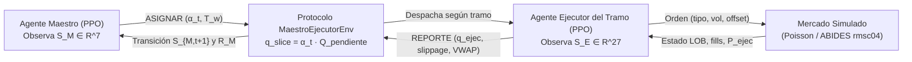

# Metodología: diseño de la solución e implementación del sistema (capítulos 4 y 5)

**Autor:** Mauricio Reynoso (MR), tarea 4.1.1 (Sprint 8). Revisión del 28 de noviembre de 2026 (PS, con apoyo de Claude Code, a partir de las observaciones del equipo): títulos en formato oración, sin nombres de archivos ni de código, tiempos y unidades unificados, y secciones nuevas 5.4 a 5.6 (arquitectura del software, calibración y validación del simulador). Pendiente de revisión por MR.
**Nota de ensamblado:** la Parte I corresponde al Capítulo 4 (diseño de la solución) y la Parte II al Capítulo 5 (implementación del sistema).

---

# Parte I (Cap. 4): Diseño de la solución

## 4.1 Formulación del problema como MDP jerárquico (CTDE)

El problema de ejecución óptima de una meta-orden institucional de compra de tamaño total $Q_{\text{total}}$ durante una jornada bursátil (09:30 a 16:00 horas) se modela mediante un esquema de **aprendizaje por refuerzo jerárquico (HRL)** con **entrenamiento centralizado y ejecución descentralizada (CTDE)**. La arquitectura descompone la toma de decisiones en dos niveles temporales acoplados mediante un protocolo de coordinación entre el Maestro y los Ejecutores:

1. **Nivel estratégico, Agente Maestro (MDP de horizonte diario):**
   opera en pasos de decisión cada $30$ minutos (hasta $13$ decisiones en una jornada completa). En cada paso $t$ observa el estado del inventario y de la sesión, y decide qué fracción del inventario remanente asignar a la siguiente ventana y por cuánto tiempo ejecutarla.
2. **Nivel táctico, Agentes Ejecutores (MDP de microestructura intradía):**
   se definen tres agentes, uno por tramo horario (**apertura** 09:30–11:30, **media jornada** 11:30–14:00 y **cierre** 14:00–16:00). Reciben una sub-orden $q_{\text{slice}}$ y una ventana $T_w$ desde el Maestro y operan sobre el libro de órdenes límite (LOB) en pasos de 30 segundos, hasta agotar la ventana o completar $q_{\text{slice}}$.



---

## 4.2 Espacios de estado y de acción

### 4.2.1 Agente Maestro ($S_M$ y $A_M$)

El vector de estado estratégico $S_M \in \mathbb{R}^7$ resume el avance de la ejecución y el contexto de la sesión:

| Índice | Variable | Definición y rango operativo |
|---|---|---|
| 0 | q_t | Fracción de inventario remanente $Q_{\text{pendiente}} / Q_{\text{total}} \in [0, 1]$ |
| 1 | tau_t | Tiempo transcurrido normalizado desde las 09:30 hasta las 16:00, $\in [0, 1]$ |
| 2 | n_slices | Fracción normalizada de decisiones consumidas en la jornada |
| 3 | volatilidad | Volatilidad realizada reciente (fija en 0,002 en el sistema base; medida en el mercado simulado en el Maestro v2) |
| 4 | vol_promedio | Volumen promedio normalizado (fijo en 0,2 en el sistema base; medido en el Maestro v2) |
| 5 | OBI_agregado | Desbalance agregado del libro de órdenes (*order book imbalance*; 0 en el sistema base, medido en el Maestro v2) |
| 6 | sesion | Tramo horario: 0,0 apertura [09:30, 11:00), 0,5 media jornada [11:00, 14:00), 1,0 cierre [14:00, 16:00] |

* **Espacio de acción $A_M$:** discreto, con $|A_M| = 40$ acciones, producto cartesiano entre:
  - $10$ fracciones del volumen pendiente: $\alpha \in \{0{,}05;\; 0{,}10;\; \dots;\; 0{,}50\}$;
  - $4$ duraciones de ventana táctica: $T_w \in \{1,\; 5,\; 10,\; 15\}$ minutos.
  - Dada una acción, la sub-orden asignada es $q_{\text{slice}} = \alpha \cdot Q_{\text{pendiente}}$.
  - **Barrido al cierre (desviación 11):** en la evaluación, la última decisión posible de la jornada fuerza $\alpha = 1{,}0$, para que no quede saldo por la restricción $\alpha \le 0{,}50$.

### 4.2.2 Agentes Ejecutores ($S_E$ y $A_E$)

El vector de estado táctico $S_E \in \mathbb{R}^{27}$ describe la microestructura instantánea del LOB:
- **3 variables privadas:** inventario restante normalizado de la sub-orden, tiempo restante normalizado de la ventana y spread relativo actual.
- **20 variables del libro de órdenes (10 de compra y 10 de venta):** precios relativos al precio medio y volúmenes normalizados de los 5 mejores niveles de cada lado.
- **4 variables de mercado:** desbalance de volumen en las puntas (OBI), retorno de corto plazo, volatilidad realizada en la ventana y tasa de llegada de órdenes (vale 0 en ABIDES, desviación 14).

* **Espacio de acción $A_E$ (desviación 2):** discreto, con $|A_E| = 240$ acciones (3 × 10 × 8):
  - **Tipo de orden (3):** esperar o cancelar, orden límite de compra u orden a mercado.
  - **Nivel de volumen (10):** fracción del saldo pendiente de la ventana (10 %, 20 %, …, 100 %).
  - **Nivel de precio (8):** desde el nivel más pasivo del libro (0) hasta el cruce agresivo (7).

---

## 4.3 Funciones de recompensa y factores de descuento

### 4.3.1 Recompensa del Maestro ($R_M$)

El Maestro recibe la recompensa al término de la jornada. Penaliza tanto el *implementation shortfall* (IS) acumulado respecto del precio de llegada $P_{\text{llegada}}$ como el inventario no ejecutado al cierre:

$$R_M = -IS_{\text{total}} - \lambda \cdot \max\bigl(0,\; Q_{\text{pendiente}}\bigr) \cdot P_{\text{mid\_cierre}}$$

donde:
- $IS_{\text{total}} = \sum_{k} (P_{\text{ejec},k} - P_{\text{llegada}}) \cdot q_k$, en pesos chilenos (CLP);
- $\lambda = 0{,}02$, calibrado por balance de escala en la tarea de recompensa del Maestro, para que la penalización por saldo residual domine el incentivo a no operar sin desestabilizar la función de valor;
- factor de descuento $\gamma_M = 0{,}99$.

**Unidades.** $R_M$ se calcula en CLP. Para entrenar y para informar, se expresa en puntos base del valor de la orden: $R_M^{\text{bps}} = R_M / (Q_{\text{total}} \cdot P_{\text{llegada}}) \times 10.000$. Las recompensas del Capítulo 6 están en esa escala.

### 4.3.2 Recompensa del Ejecutor ($R_E$)

En cada paso táctico $t$ dentro de la ventana, el Ejecutor recibe una recompensa por ejecutar bajo el precio medio, penalizada por aversión al riesgo de volatilidad:

$$R_{E,t} = \bigl(P_{\text{mid},t} - P_{\text{ejec},t}\bigr) \cdot q_t - \beta \cdot \sigma^2 \cdot q_t$$

donde:
- $\beta = 0{,}0061796$, calibrado con un barrido en dos fases en la tarea de recompensa de los Ejecutores;
- factor de descuento $\gamma_E = 1{,}0$ (desviación 6): con el $\gamma_E = 0{,}95$ del Título I, el agente aprendía a postergar las compras hasta el último paso. Con $\gamma_E = 1{,}0$ y una penalización por saldo al cierre de la ventana, se garantiza el cumplimiento completo.

---

## 4.4 Arquitectura de redes neuronales y algoritmo PPO

### 4.4.1 Arquitectura Actor-Crítico

El Maestro y cada Ejecutor usan la misma arquitectura base: un perceptrón multicapa con un tronco compartido y dos cabezas.

$$\text{Tronco compartido:} \quad \mathbf{h} = \text{ReLU}\bigl(W_2 \cdot \text{ReLU}(W_1 \mathbf{s} + \mathbf{b}_1) + \mathbf{b}_2\bigr), \quad W_1 \in \mathbb{R}^{256 \times d_{\text{in}}},\; W_2 \in \mathbb{R}^{256 \times 256}$$

$$\text{Cabeza actor:} \quad \pi_\theta(a \mid \mathbf{s}) = \text{Softmax}(W_\pi \mathbf{h} + \mathbf{b}_\pi), \qquad \text{Cabeza crítico:} \quad V_\phi(\mathbf{s}) = W_v \mathbf{h} + b_v$$

La cabeza actor entrega la probabilidad de cada acción y la cabeza crítico estima el valor del estado.

### 4.4.2 Optimización PPO (*Proximal Policy Optimization*)

Los parámetros $(\theta, \phi)$ se actualizan con **PPO-Clip** y estimación de ventaja generalizada (**GAE**):

$$\hat{A}_t = \sum_{l=0}^{T-t-1} (\gamma \lambda_{\text{GAE}})^l \, \delta_{t+l}, \qquad \delta_t = r_t + \gamma V_\phi(s_{t+1}) - V_\phi(s_t)$$

La función objetivo que se maximiza por gradiente estocástico es:

$$L^{\text{PPO}}(\theta, \phi) = \hat{\mathbb{E}}_t \Bigl[ \min\bigl(r_t(\theta)\hat{A}_t,\; \text{clip}(r_t(\theta), 1-\epsilon, 1+\epsilon)\hat{A}_t\bigr) - c_1 \bigl(V_\phi(s_t) - \hat{R}_t\bigr)^2 + c_2 \, \mathcal{H}\bigl[\pi_\theta(\cdot \mid s_t)\bigr] \Bigr]$$

donde $r_t(\theta) = \frac{\pi_\theta(a_t \mid s_t)}{\pi_{\theta_{\text{old}}}(a_t \mid s_t)}$ es la razón entre la política nueva y la anterior, $\epsilon = 0{,}2$ y $\lambda_{\text{GAE}} = 0{,}95$. El primer término limita cuánto cambia la política en cada actualización, el segundo entrena al crítico y el tercero (entropía) mantiene la exploración.

---

## 4.5 Análisis de alternativas: ventajas, desventajas y costo computacional

| Decisión de diseño | Alternativa descartada | Ventajas de la opción elegida | Desventajas y límites | Costo computacional |
|---|---|---|---|---|
| **PPO-Clip discreto** | DQN, SAC o A2C | Actualizaciones estables gracias al recorte (*clipping*); admite espacios discretos grandes (40 y 240) | Menor eficiencia muestral que los algoritmos *off-policy* (requiere nuevas trayectorias en cada época) | Red pequeña (≈ 61.600 parámetros en la cabeza); entrenamiento liviano en CPU |
| **Cabeza discreta de 240 salidas** (desviación 2) | Cabeza híbrida (discreta + gaussiana continua) | Evita mezclar gradientes de familias distintas y los problemas en los bordes de [0, 1] | Discretiza el volumen en pasos de 10 % | Despreciable (< 1 ms por decisión) |
| **Arranque por imitación + PPO** (desviación 9) | PPO desde pesos aleatorios | Acelera la convergencia hacia órdenes límite y evita que el agente se paralice | Sesga la inicialización hacia políticas tipo TWAP con órdenes límite | ≈ 57 min en Colab (3.437,5 s medidos para 100 episodios de imitación y 1.000 de PPO) |
| **Entrenar el Maestro en Poisson y evaluarlo en ABIDES** | Entrenar el Maestro directamente en ABIDES | Permite completar 2.000 jornadas en un tiempo viable | Brecha entre simuladores; el Maestro ve un solo tamaño de orden (10 % del volumen) | **Poisson:** ≈ 40 min en Colab. **ABIDES:** inviable (> 100 h para 2.000 jornadas) |
| **Una red de Ejecutor para los 3 tramos** (desviación 8) | Entrenar redes independientes para media jornada y cierre | Evita simular desde las 09:30 en cada episodio de cierre en ABIDES | Menor especialización en la microestructura de media jornada y cierre | Ahorro de ≈ 12 h de cómputo por tramo |

---

# Parte II (Cap. 5): Implementación del sistema

## 5.1 Entornos de simulación (ABIDES y Poisson)

El sistema integra dos simuladores intercambiables bajo una interfaz común de entorno de aprendizaje por refuerzo (Gym 0.18.0 para ABIDES y Gymnasium 0.29.1 para el resto del sistema):

1. **Simulador de microestructura ABIDES (configuración RMSC04 calibrada para el IPSA):**
   calibrado con datos intradía de FALABELLA, COPEC y ECL (*snapshot* del 23 de agosto de 2026; ver la sección 5.5). Opera internamente en décimos de peso (1 CLP = 10 unidades de precio). Un puente de unidades (desviación 5) traduce los precios de ejecución y el precio medio a CLP, para preservar la escala de $R_M$ y de $\lambda$.
2. **Simulador estocástico de Poisson:**
   calibrado por tramo horario para reproducir la tasa de llegada de órdenes límite y de mercado y el spread del mercado chileno. Se usa para entrenar rápidamente al Maestro (2.000 jornadas).
3. **Impacto acumulado entre ventanas (desviación 7):**
   como cada ventana táctica instancia un mercado independiente, se arrastra el impacto permanente entre ventanas con decaimiento exponencial y la ley de raíz cuadrada:
   $$\Delta P_t = Y \cdot \sigma_{\text{día}} \cdot \sqrt{\frac{Q_{\text{efectiva},t}}{V_{\text{día}}}}, \qquad Q_{\text{efectiva},t} = Q_{\text{efectiva},t-1} \cdot e^{-\Delta t / \tau} + q_{\text{ejec},t}$$
   con $Y = 0{,}5$ y $\tau = 120$ min, valores tomados de la literatura de impacto en raíz cuadrada (Almgren et al., 2005; Bouchaud et al., 2004) y no calibrados con datos del IPSA. Se aplica igual al sistema PPO, a TWAP y a VWAP en la evaluación.

---

## 5.2 Entrenamiento del sistema final

El entrenamiento se hizo por etapas en Google Colab (CPU, Python 3.9):

1. **Fase 1, Ejecutor:**
   preentrenamiento por clonación de comportamiento (*imitation learning*) sobre una heurística de TWAP con órdenes límite, seguido de un ajuste fino con PPO durante 1.000 episodios ($\gamma_E = 1{,}0$, $\beta = 0{,}0061796$). La red elegida se asignó a los tres tramos horarios.
2. **Fase 2, Maestro:**
   con los pesos de los Ejecutores fijos, se entrenó el Maestro durante 2.000 jornadas en el simulador de Poisson ($\lambda = 0{,}02$, $\gamma_M = 0{,}99$; duración ≈ 40 min).

---

## 5.3 Pseudocódigo del ciclo CTDE y de la evaluación pareada

```text
ALGORITMO 1: Ciclo de ejecución jerárquica (Maestro y Ejecutores)
Entrada: meta-orden (acción, tramo de inicio, Q_total), semilla s, política del Maestro π_M, políticas de los Ejecutores {π_E}
1. Inicializar Q_pendiente ← Q_total, t ← hora de inicio del tramo, impacto acumulado ← 0
2. Observar el estado inicial del Maestro S_M (lo pendiente, la hora y el historial)
3. MIENTRAS Q_pendiente > 0 Y t < 16:00 HACER:
4.     Elegir (α, T_w) con la política del Maestro π_M(S_M)
5.     SI es la última decisión posible de la jornada ENTONCES α ← 1,0   // barrido al cierre
6.     q_slice ← α · Q_pendiente
7.     tramo ← tramo horario de t (apertura, media jornada o cierre)
8.     Crear el mercado simulado de la ventana con la semilla pareada (s, t) y el impacto acumulado
9.     El Ejecutor del tramo compra q_slice en pasos de 30 s durante T_w minutos → (q_ejec, monto_ejec)
10.    Actualizar el impacto acumulado con q_ejec (decaimiento en 30 min)
11.    Q_pendiente ← Q_pendiente − q_ejec;  t ← t + 30 min
12.    Observar el nuevo estado S_M
13. FIN MIENTRAS
14. Retornar IS (bps) = (monto total / acciones compradas − P_llegada) / P_llegada × 10.000
```

---

## 5.4 Arquitectura del software

El sistema se implementó en Python, con PyTorch para las redes (Paszke et al., 2019), NumPy y Pandas para el procesamiento de datos (Harris et al., 2020; McKinney, 2010) y ABIDES-Gym para el mercado simulado (Amrouni et al., 2021). El código se organiza en módulos con responsabilidades separadas:

| Módulo | Contenido |
|---|---|
| Datos | Descarga de velas de 5 minutos de las 30 acciones del IPSA, limpieza, imputación y normalización |
| Variables | Construcción de las variables del estado del Maestro a partir de los datos |
| Entornos | Simulador de Poisson, adaptador de ABIDES, puente de unidades, protocolo de coordinación Maestro–Ejecutores, impacto acumulado y calibración de los simuladores |
| Modelos | Redes Actor-Crítico del Maestro y de los Ejecutores |
| Entrenamiento | Algoritmo PPO, entrenamiento del Maestro y monitoreo de las curvas de aprendizaje |
| Análisis | Métricas de ejecución (IS, cumplimiento), benchmarks TWAP y VWAP, validación del simulador y pruebas estadísticas |
| Experimentos | Barridos de recompensa, meta-órdenes de prueba y pruebas de confirmación |

**Pruebas automáticas.** El repositorio tiene 72 archivos de pruebas con unas 500 pruebas unitarias e integradas. Verifican, entre otras cosas, las dimensiones de los espacios de estado y acción, la conversión de unidades, el protocolo de mensajes, las métricas de costo y que las tablas y figuras del informe coincidan con los datos consolidados.

**Ejecución en Colab.** Las corridas largas (entrenamiento de los Ejecutores, evaluación final y controles) se ejecutaron con cuadernos de Google Colab versionados en el repositorio. Sus resultados se guardaron como archivos JSON y se consolidaron con scripts reproducibles (Anexo C).

---

## 5.5 Calibración del simulador ABIDES

La configuración de referencia RMSC04 de ABIDES-Gym simula un mercado con 1.000 agentes de ruido, 102 agentes de valor, 12 de momentum y 2 creadores de mercado (*market makers*). Sus parámetros por defecto describen una acción genérica, así que se ajustaron con datos reales de FALABELLA (y después de COPEC y ECL):

1. **Nivel de precios y volatilidad.** El precio se fijó en la mediana observada. La volatilidad del valor fundamental se derivó, por tramo horario, de la desviación de los retornos de 5 minutos, corrigiendo un error de unidades de la configuración inicial (el simulador mide el tiempo en nanosegundos).
2. **Unidad de cuenta.** Se eligió para que el tick del simulador coincidiera con el incremento mínimo de precio observado.
3. **Reversión.** Una prueba de razón de varianzas mostró reversión en los retornos de 5 minutos, pero con la forma del rebote entre precios de compra y de venta, así que no se agregó reversión al valor fundamental.
4. **Creador de mercado y actividad.** Como no pueden estimarse sin datos del libro de órdenes, se buscaron en una grilla de 27 combinaciones (ventana del creador de mercado, profundidad `mm_pov` y nivel de actividad) por **método de momentos simulados**: se minimiza la distancia entre la volatilidad de 5 minutos, el spread, la participación de cada tramo en el volumen del día y el volumen por vela, simulados y observados.

**Resultado.** Con 30 simulaciones nuevas por tramo, la volatilidad de 5 minutos quedó dentro de un 10 % de la observada (34,0; 20,0 y 20,5 bps simulados frente a 34,0; 22,3 y 20,9 reales en apertura, media jornada y cierre). La participación de cada tramo en el volumen se aproximó a la observada, y el volumen por vela resultó entre un 4 % y un 49 % mayor.

**Profundidad del market maker.** El parámetro `mm_pov` fija la fracción del volumen del último minuto que el creador de mercado pone en cada nivel del libro. Los escenarios de la evaluación lo multiplican por 4, 1 y 0,25. Al contrario de lo esperado, con más `mm_pov` comprar a mercado cuesta **más** (25,05 bps con ×4, 18,36 con ×1 y 10,81 con ×0,25 en la prueba de confirmación). La explicación más probable, no medida directamente, es que con más `mm_pov` el creador de mercado negocia más y su cotización sigue más de cerca al precio, de modo que el precio reacciona más a una compra grande; en la calibración, subir `mm_pov` también duplicaba el volumen. Una compra con órdenes límite casi no cambia de costo entre escenarios. Por eso los escenarios se informan como profundidad del market maker y no como liquidez baja, media y alta (Capítulo 6, sección 6.1.1).

---

## 5.6 Validación del simulador

Los criterios de validación se fijaron antes de ver los datos (Capítulo 3, sección 3.7) y se aplicaron a FALABELLA con 30 semillas simuladas por tramo, comparando contra el *snapshot* real del 23 de agosto de 2026:

| Criterio | Qué exige | ¿Cumple? |
|---|---|---|
| A. Literal del plan | Todas las pruebas de Kolmogórov-Smirnov (KS) y Mann-Whitney por tramo con p > 0,05 | No |
| B. Forma | KS con muestras estandarizadas, p > 0,05 en los 3 tramos | No |
| C. Tamaño del efecto | Diferencia de escala trivial: \|g de Hedges\| < 0,5 en los 3 tramos | Sí |
| D. Patrón intradiario | Volatilidad máxima en la apertura y volumen por vela creciente hacia el cierre | Sí |

**Lectura de los resultados:**
- **Distribución de retornos.** El KS rechaza la igualdad en los tres tramos, pero por poco: la distancia máxima entre las distribuciones acumuladas (D = 0,066 a 0,098) apenas supera el valor crítico (entre 1,03 y 1,75 veces). Antes de calibrar era de 0,28 a 0,32. Con miles de retornos, el KS detecta diferencias pequeñas.
- **Escala.** La magnitud de los retornos es prácticamente igual (g de Hedges entre −0,03 y 0,01, efecto trivial).
- **Volatilidad y volumen.** La volatilidad simulada queda entre un 8 % y un 14 % bajo la real; el volumen por vela, entre un 5 % y un 50 % sobre la real.
- **Spread.** El spread simulado (0,17 bps, uno a dos ticks) es entre 25 y 33 veces menor que el rango de estimadores indirectos del spread real. Es la principal limitación: el costo absoluto de ejecución queda subestimado, y las conclusiones deben leerse como comparaciones entre estrategias en el mismo mercado simulado.
- **Ensanchamiento del spread en media jornada.** El Título I esperaba un spread mayor en la media jornada; los datos reales lo refutan (patrón en «L», Capítulo 3, sección 3.5), y el simulador no lo reproduce porque su spread es casi constante.

**Veredicto.** Según el criterio literal del plan, el simulador **no es válido** como réplica de la distribución de retornos. Sí aproxima la escala de los retornos, la volatilidad y el patrón intradiario, que son las magnitudes que más influyen en el costo de ejecución. Por eso se usa para comparar estrategias, con los límites declarados. COPEC y ECL se validaron con el mismo procedimiento.

---

## 5.7 Desviaciones respecto del Título I

Las diferencias entre lo especificado en el Título I y lo implementado, con su justificación y su efecto en los resultados, se registran en el Anexo A.
