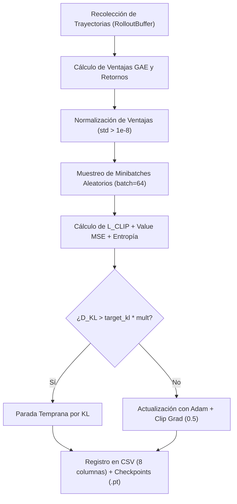

# Ciclo de Entrenamiento PPO Unificado (Tarea 2.3.2)

**Elaborado por:** Mauricio Reynoso (MR)  
**Fecha:** Octubre 2026 (Sprint 5)  
**Revisión:** Paolo Sepúlveda (PS) y Benjamín Farías (BF)  
**Código fuente:** [`src/training/ppo_trainer.py`](file:///c:/Users/rokla/workspace/titulo/slippage/src/training/ppo_trainer.py)  
**Batería de pruebas:** [`tests/test_ppo_trainer.py`](file:///c:/Users/rokla/workspace/titulo/slippage/tests/test_ppo_trainer.py)

---

## 1. Propósito y Estructura del Entrenador

La tarea 2.3.2 unifica los componentes dispersos de entrenamiento desarrollados en los Sprints 3 y 4 (`RolloutBuffer`, `ppo_update` en `test_ppo_short_run.py`, y `beta_phase2.py`) en un motor reutilizable y parametrizable: [`PPOTrainer`](file:///c:/Users/rokla/workspace/titulo/slippage/src/training/ppo_trainer.py).

El entrenador soporta tanto a los **Agentes Ejecutores** ($S_E \in \mathbb{R}^{27}$, $A_E \in \{0, \dots, 239\}$) como al **Agente Maestro** ($S_M \in \mathbb{R}^7$, $A_M \in \{0, \dots, 39\}$), implementando las mejores prácticas de estabilidad de RL en microestructura financiera:



---

## 2. Componentes Clave de la Implementación

### 2.1 Buffer de Experiencias y Generalized Advantage Estimation (GAE)
La clase [`RolloutBuffer`](file:///c:/Users/rokla/workspace/titulo/slippage/src/training/ppo_trainer.py#L42) almacena $(s_t, a_t, \log \pi(a_t|s_t), r_t, V(s_t), d_t)$ y calcula ventajas $A_t^{\text{GAE}(\gamma, \lambda)}$ mediante recursión invertida:

$$\delta_t = r_t + \gamma V(s_{t+1})(1 - d_t) - V(s_t)$$
$$A_t = \delta_t + \gamma \lambda (1 - d_t) A_{t+1}$$

La presencia de $(1 - d_t)$ corta rigurosamente la propagación de bootstrapping temporal entre episodios contiguos dentro de una misma tanda de actualización.

### 2.2 Parada Temprana por Divergencia KL (Early Stopping)
Para evitar que la política actual sufra divergencia catastrófica por gradientes ruidosos en series financieras de ordenes límite, se monitorea la divergencia KL aproximada en cada minilote:

$$D_{\text{KL}}(\pi_{\text{old}} \parallel \pi) \approx \mathbb{E}\left[ \frac{\pi(a|s)}{\pi_{\text{old}}(a|s)} - 1 - \log \left(\frac{\pi(a|s)}{\pi_{\text{old}}(a|s)}\right) \right]$$

Si $D_{\text{KL}} > \text{target\_kl} \times \text{kl\_threshold\_multiplier}$ ($0{,}015 \times 1{,}5 = 0{,}0225$), se interrumpe de inmediato el bucle de épocas en curso, preservando la estabilidad del entrenamiento.

### 2.3 Registro en CSV y Checkpoints
- **Columnas de CSV (`PPOTrainer.CSV_HEADER`):**
  1. `episodio`: Número acumulado de episodios transcurridos.
  2. `loss_actor`: Pérdida promedio de la política ($L^{\text{CLIP}}$).
  3. `loss_critic`: Error cuadrático medio de la función de valor ($L_V$).
  4. `entropia`: Bonificación de entropía promedio de la distribución de acciones.
  5. `reward_mean`: Retorno medio obtenido en la ventana de episodios.
  6. `reward_std`: Desviación estándar del retorno.
  7. `kl`: Divergencia KL promedio registrada durante el update.
  8. `clip_fraction`: Fracción de transiciones donde el ratio $r_t$ fue recortado por $1 \pm \epsilon$.

- **Manejo de Checkpoints:**
  Guarda de forma atómica tanto `checkpoint_last.pt` como `checkpoint_best.pt` (según mejor retorno medio), almacenando pesos de la red, estado del optimizador Adam, contador de episodios y configuración de hiperparámetros.

---

## 3. Hiperparámetros Iniciales

Los hiperparámetros por defecto provienen de la calibración de la fase 2 de $\beta$ y del Título I:

| Hiperparámetro | Valor Ejecutor | Valor Maestro | Justificación |
|---|:---:|:---:|---|
| **Learning Rate (lr)** | $3 \times 10^{-4}$ | $3 \times 10^{-4}$ | Tasa estándar Adam para redes MLP de 2 capas de 256 |
| **Factor de descuento ($\gamma$)** | $0{,}95$ | $0{,}99$ | Horizonte táctico de 30 min (Ejecutor) vs jornada completa de 390 min (Maestro) |
| **GAE Lambda ($\lambda_{\text{GAE}}$)** | $0{,}95$ | $0{,}95$ | Balance óptimo sesgo-varianza en ventajas |
| **Ratio de Clip ($\epsilon$)** | $0{,}20$ | $0{,}20$ | Margen de confianza PPO estándar |
| **Coeficiente de Entropía ($c_2$)** | $0{,}01$ | $0{,}01$ | Fomenta exploración táctica inicial en el espacio de 240 acciones |
| **Coeficiente de Valor ($c_1$)** | $0{,}50$ | $0{,}50$ | Escala el gradiente de la función crítica respecto al actor |
| **Max Gradient Norm** | $0{,}50$ | $0{,}50$ | Evita explosión de gradientes por shocks de microestructura |
| **Épocas por actualización** | 4 | 4 | Reutilización conservadora para mitigar sobreajuste |
| **Minibatch Size** | 64 | 64 | Lotes estables para SGD sobre tensores de PyTorch |
| **Episodios por Update** | 10 | 10 | Agregación de trayectorias antes del paso de gradiente |
| **Target KL** | $0{,}015$ | $0{,}015$ | Umbral de divergencia según Schulman et al. |

---

## 4. Guía de Uso Rápido

### 4.1 Entrenamiento de un Ejecutor (para Tarea 2.3.5 de BF)
```python
from src.training.ppo_trainer import PPOTrainer, PPOConfig
from src.envs.abides_ejecutor_env import EjecutorEnvAbides

# 1. Configurar entrenador
cfg = PPOConfig(episodes_per_update=10, epochs=4, lr=3e-4)
trainer = PPOTrainer(role="ejecutor", cfg=cfg, seed=1000)

# 2. Entrenar 100 episodios en apertura
historial = trainer.train_executor_episodes(
    env_factory=EjecutorEnvAbides,
    n_episodes=100,
    tramo="apertura",
    q_slice=1000,
    ventana_min=5,
    csv_path="data/training_logs/ejecutor_apertura_p5.csv",
    checkpoint_dir="data/checkpoints/ejecutor_apertura/",
    checkpoint_freq=10,
)
```

### 4.2 Reanudación desde Checkpoint
```python
trainer_resumed = PPOTrainer(role="ejecutor", seed=1000)
trainer_resumed.load_checkpoint("data/checkpoints/ejecutor_apertura/checkpoint_last.pt")

# Continua entrenando sin discontinuidad de estado
trainer_resumed.train_executor_episodes(
    env_factory=EjecutorEnvAbides,
    n_episodes=50,
    csv_path="data/training_logs/ejecutor_apertura_p5.csv",
)
```

---

## 5. Resultados de Validación de Tests

En [`tests/test_ppo_trainer.py`](file:///c:/Users/rokla/workspace/titulo/slippage/tests/test_ppo_trainer.py):
- `test_rollout_buffer_y_gae`: Validación matemática de cálculo de GAE en episodios particionados (`PASSED`).
- `test_reproducibilidad_misma_semilla`: Dos corridas con la misma semilla reproducen exactamente los mismos losses y retornos (`PASSED`).
- `test_parada_temprana_por_kl`: Se constató que `early_stopped=True` cuando la divergencia excede el target configurado (`PASSED`).
- `test_checkpoint_y_reanudacion`: Guardado y reanudación sin pérdida de estado ni salto de episodio (`PASSED`).
- `test_corrida_20_episodios_sin_nans_y_csv_valido`: Corrida de 20 episodios continuos verificando cero valores NaN y comprobando el formato estricto del archivo CSV (`PASSED`).
