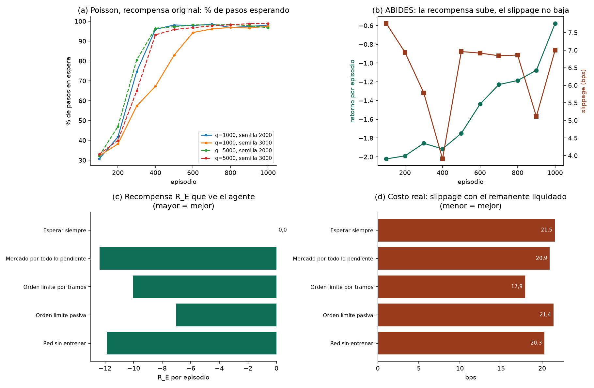

# Diagnóstico: por qué el entrenamiento no baja el costo

**Elaborado por:** PS con apoyo de Claude Code (uso autorizado por la universidad). **Pendiente de revisión por:** BF (R_E) y MR (entrenamiento).

Este documento reúne la evidencia de las fases 0 y 1 del plan de investigación. Se genera con `scripts/diagnostico_recompensa_ps.py`; los números salen de los archivos del repositorio y de corridas en el PC con el simulador de Poisson.

## 1. Qué se observó
- Con 1.000 episodios, las redes entrenadas con R_E cuestan **más** que la misma red sin entrenar (+3,08 bps, 0 de 6 redes mejores; `docs/estabilidad_D3_1000ep_PS.md`). **Nota del 26 de octubre (noche), 300 semillas:** la reevaluación con 300 semillas de evaluación (`docs/reeval_300_resultado_PS.md`) mostró que ninguna de las 8 redes entrenadas cuesta distinto a su control (diferencias de −0,6 a +1,0 bps, todos los intervalos con el 0). Las cifras de 15 y 40 semillas de este documento eran ruido del precio y no deben citarse como evidencia de costo; el cumplimiento y el colapso a esperar no dependen de eso.
- En el entrenamiento la recompensa mejora, pero el slippage frente al precio de llegada no, y la conducta cambia de órdenes de mercado a órdenes límite pasivas.

## 2. Reproducción en el PC (Poisson, recompensa original)

| Tamaño del slice | Semilla de red | Pasos en espera: ep. 1-100 | ep. 451-550 | ep. 901-1000 | Cumplimiento voluntario al final |
|---:|---:|---:|---:|---:|---:|
| 1000 | 2000 | 31 % | 98 % | 98 % | 0,04 |
| 1000 | 3000 | 32 % | 83 % | 98 % | 0,07 |
| 5000 | 2000 | 32 % | 97 % | 97 % | 0,03 |
| 5000 | 3000 | 33 % | 96 % | 99 % | 0,02 |

La red aprende a no operar: pasa de esperar ≈ 30 % de los pasos (política inicial casi uniforme) a esperar casi todos. La corrida entera dura cerca de un minuto, así que se puede repetir cuantas veces haga falta.

## 3. Auditoría de R_E

Estrategias simples en 50 semillas nuevas, slice de 5.000 acciones y ventana de 15 min. «R_E visto» es la recompensa que recibe el agente hoy; «slippage» es el costo real frente al precio de llegada, **liquidando a mercado lo que no se compró** para que todas las filas sean comparables.

| Estrategia | R_E visto por el agente | R_E si se liquida el remanente | Slippage (bps) | Cumplimiento voluntario | Pasos en espera |
|---|---:|---:|---:|---:|---:|
| Esperar siempre | 0,00 | -12,14 | 21,53 | 0,00 | 100 % |
| Mercado por todo lo pendiente (agresiva) | -12,38 | -12,38 | 20,93 | 1,00 | 0 % |
| Orden límite por tramos (TWAP límite) | -10,04 | -10,28 | 17,91 | 0,98 | 0 % |
| Orden límite pasiva | -7,02 | -12,11 | 21,37 | 0,57 | 0 % |
| Red sin entrenar (muestreando) | -11,89 | -11,89 | 20,26 | 1,00 | 30 % |

**Lectura:** con la recompensa original, *esperar siempre* obtiene la mayor recompensa posible (cero: no paga ningún costo), aunque no compra nada. Operar siempre cuesta recompensa, porque cada compra paga el spread frente al precio medio. Nada en R_E obliga a completar la orden (la penalización por lo no ejecutado está en R_M, que todavía no se entrena) ni castiga el costo de esperar frente al precio de llegada. Por eso el óptimo de R_E y el óptimo de la evaluación no coinciden.

**El orden de las estrategias también se invierte.** La orden límite pasiva recibe mejor R_E que el TWAP con órdenes límite y cuesta bastante más en la realidad, porque la parte que no logra comprar no entra en R_E. Una red que maximiza R_E tiende, entonces, a preferir lo pasivo y lo que no compra.

## 4. Evidencia en ABIDES (corridas de 1.000 episodios)

| Corrida | Recompensa (ep. 1-100 → 901-1000) | Slippage (bps) | Mercado | Límite de compra | Espera |
|---|---|---|---|---|---|
| d3_opcion0_s2000 | -2,05 → -0,37 | 8,4 → 8,4 | 35 % → 3 % | 34 % → 86 % | 30 % → 11 % |
| d3_opcion0_s3000 | -1,47 → -0,81 | 7,7 → 5,7 | 37 % → 17 % | 33 % → 50 % | 31 % → 32 % |
| d3_opcionA_s2000 | -2,62 → -1,06 | 8,5 → 7,5 | 35 % → 10 % | 34 % → 82 % | 30 % → 8 % |
| d3_opcionA_s3000 | -1,95 → -0,08 | 6,4 → 6,4 | 36 % → 5 % | 33 % → 89 % | 31 % → 6 % |

La recompensa mejora en todas las corridas, el slippage queda igual o peor, y las órdenes de mercado se reemplazan por órdenes límite pasivas, que R_E premia (comprar bajo el precio medio da recompensa positiva) y que la evaluación no recompensa.

## 5. Potencia de la evaluación

El desvío de la diferencia pareada (entrenada − red inicial, por semilla de evaluación) es de 9,10 bps (mediana de 6 corridas). Semillas de evaluación necesarias para detectar una diferencia (prueba bilateral, 5 %, potencia 80 %):

| Diferencia a detectar | Semillas necesarias |
|---:|---:|
| 1 bps | 650 |
| 2 bps | 163 |
| 3 bps | 73 |

Con 15 semillas solo se detectan diferencias grandes. Los experimentos nuevos evalúan con 50 semillas.

## 6. Tamaño de las órdenes: entrenamiento frente a uso

El Ejecutor se entrena con slices de 1.000 acciones. En la evaluación del sistema completo (sin entrenar), cada ventana compra entre 253 (percentil 10) y 7.489 (percentil 90) acciones, con mediana de 1.671 y máximo de 27.701 (180 ventanas). La red se usaría en un rango de tamaños que no vio al entrenar.

## 7. Conclusión

1. **Desalineación entre recompensa y métrica (confirmada en Poisson, visible en ABIDES):** R_E premia no pagar ahora y no exige completar; la evaluación mide el costo total frente al precio de llegada.
2. **El simulador de Poisson con 1.000 acciones casi no distingue estrategias** (todas ≈ 18 bps), de modo que ahí no hay nada que aprender; hay que entrenar con tamaños donde sí importa (desde ≈ 5.000 acciones).
3. **Faltan semillas de evaluación** para detectar diferencias de 1 a 3 bps.
4. **El tamaño de entrenamiento no coincide con el de uso.**
5. **El factor de descuento del Ejecutor (γ = 0,95) agrava el problema.** Con ventanas de 30 pasos, un costo que llega al final de la ventana (por ejemplo, el de lo que quedó sin comprar) se ve desde el primer paso multiplicado por 0,95²⁹ ≈ 0,23: parece cuatro veces más barato de lo que es. Es una causa distinta de la recompensa y se comprobó por separado (`docs/experimentos_recompensa_A2_PS.md`).
Los arreglos que se probaron para cada punto y sus resultados están en `docs/experimentos_recompensa_PS.md`.

🤖 Generado con [Claude Code](https://claude.com/claude-code)
