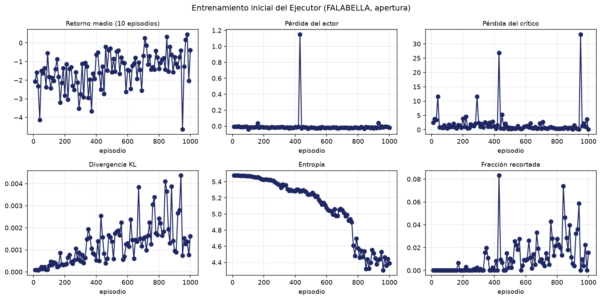

# Entrenamiento inicial de validación del Ejecutor (tarea 2.3.5)

**Borrador elaborado por:** Paolo Sepúlveda (PS) con apoyo de Claude Code. **Pendiente de revisión por:** Benjamín Farias (BF), responsable de la 2.3.5, y Mauricio Reynoso (MR, entrenador PPO). Lo que BF no acepte se cambia o se descarta; nada aquí está cerrado hasta su revisión.

## 1. Qué se hizo

Se entrenó un Ejecutor con el entrenador PPO de MR (`PPOTrainer`, 2.3.2) durante **1000 episodios** sobre ABIDES calibrado (FALABELLA, tramo apertura, `rmsc04_ipsa_FALABELLA_2026-08-23.json`), con `q_slice` = 1000 acciones y ventana de 15 minutos. Recompensa: R_E según el Título I con β = 0,0061796 (opción 0 de D3). Semillas de entrenamiento 1001–2000; evaluación en 15 semillas nuevas (5001–5015). No se usaron las 10 meta-órdenes oficiales.

Hiperparámetros (los mismos de la fase 2 de β): γ 0,95; λ GAE 0,95; lr 3e-4; clip 0,2; entropía 0,01; coeficiente de valor 0,5; 4 épocas; minilote 64; 10 episodios por actualización.

## 2. Curvas de entrenamiento



- **Actualizaciones registradas:** 100 (una cada 10 episodios). **Valores no finitos (NaN o infinito) en el CSV:** 0.
- **Retorno medio:** -2,002 en el primer tercio y -1,002 en el último. **Pérdida del crítico:** 2,195 y 1,813.
- **KL máximo:** 0,00438 (el objetivo del entrenador es 0,015; la actualización se corta si lo supera 1,5 veces).
- **Entropía:** de 5,4793 a 4,3901; una política uniforme sobre las 240 acciones tiene 5,4806. La política final conserva el 80,10 % de la entropía máxima, es decir, se fue concentrando en algunas acciones.
- **Tiempo de entrenamiento:** 38,8 min.

## 3. Evaluación (semillas nuevas, política determinista)

| Política | Slippage medio (bps) | Error estándar | Cumplimiento |
|---|---:|---:|---:|
| Red entrenada (política determinista, argmax) | — | — | 0,000 |
| Red entrenada (política muestreada, como al entrenar) | 5,43 | 5,68 | 1,000 |
| Red sin entrenar (control, argmax) | 6,02 | 4,68 | 1,000 |
| Referencia: agresiva_market | 10,45 | 4,39 | 1,000 |
| Referencia: twap_limit_medio | 1,78 | 4,58 | 0,971 |
| Referencia: pasiva_limit | 7,88 | 4,69 | 1,000 |

Comparación pareada por semilla (red entrenada con política muestreada menos cada alternativa; negativo = la red entrenada tiene menos slippage):

| Contra | Diferencia media (bps) | Error estándar | p (Wilcoxon) |
|---|---:|---:|---:|
| Red sin entrenar (control) | -0,58 | 4,68 | 0,679 |
| Referencia: agresiva_market | -5,02 | 5,09 | 0,121 |
| Referencia: twap_limit_medio | 3,66 | 2,47 | 0,277 |
| Referencia: pasiva_limit | -2,44 | 2,92 | 0,208 |

### Diagnóstico de la política (checkpoint del episodio 1000)

Tres episodios de evaluación; `scripts/colab/diagnostico_politica_entrenada_ps.py` imprime las acciones paso a paso.

| Modo | Cumplimiento medio | Acciones más usadas (todas las semillas) |
|---|---:|---|
| determinista | 0,000 | `LIMIT_SELL / bucket5 / nivel4` ×89, `LIMIT_SELL / bucket3 / nivel0` ×1 |
| estocastico | 0,997 | `LIMIT_SELL / bucket5 / nivel4` ×11, `LIMIT_SELL / bucket3 / nivel0` ×10, `LIMIT_SELL / bucket8 / nivel1` ×6 |

En el puente de ABIDES, `LIMIT_SELL` se traduce a «esperar» (el proyecto solo modela compra): no envía ninguna orden (`src/envs/abides_bridge.py`, `map_action_to_abides_orders`).


### Comparación de corridas

Misma evaluación (15 semillas nuevas, FALABELLA, apertura). Slippage en bps, con el error estándar entre paréntesis; la diferencia es contra la red sin entrenar, pareada por semilla.

| Corrida | Episodios | Riesgo sobre | Argmax: cumplimiento | Argmax: slippage | Argmax: dif. vs control | Muestreada: cumplimiento | Muestreada: slippage | Muestreada: dif. vs control |
|---|---:|---|---:|---|---|---:|---|---|
| Esta corrida | 1000 | ejecutado | 0,000 | sin ejecuciones | — | 1,000 | 5,43 (5,68) | -0,58 (p = 0,679) |
| 1000 episodios, opción A de D3 | 1000 | pendiente | 1,000 | 5,91 (3,21) | -0,10 (p = 0,524) | 1,000 | 4,60 (3,06) | -1,42 (p = 0,804) |
| 100 episodios, opción 0 | 100 | ejecutado | 1,000 | 3,28 (2,45) | -2,74 (p = 0,762) | — | — | — |


## 4. Regla de vigilancia de D3

Cumplimiento medio de la red entrenada: **0,000** (umbral 0,95). El cumplimiento de la red entrenada es < 95 %: segun la regla de D3 corresponde pasar a la opcion A (riesgo sobre lo pendiente) y recalcular beta*. La decisión final de R_E se revisa el viernes 23 de octubre y es de BF.

## 5. Lectura preliminar de PS (BF debe confirmar, corregir o reemplazar)

- **La red entrenada no ejecutó la orden en la evaluación:** cumplimiento medio 0,000 y sin slippage medible en las 15 semillas. Con la política determinista (argmax) la red no llega a ejecutar nada; por eso no hay comparación pareada.
- **Muestreando la política (como al entrenar) sí se ejecuta:** cumplimiento 1,000 y slippage 5,43 bps (EE 5,68), frente a 6,02 bps de la red sin entrenar (diferencia pareada -0,58 bps, p = 0,679). La evaluación con argmax y la política que se entrena son cosas distintas: el argmax puede caer en una acción que no hace nada.
- **Entropía de la política:** 4,3901 frente a 5,4806 de una política uniforme (80,1 % del máximo): la política se concentró.
- **D3:** el cumplimiento de la red entrenada es 0,000, por debajo del 95 %; la regla del plan indica pasar a la opción A (riesgo sobre lo pendiente). La decisión es de BF.
- **Con la opción A de D3 (riesgo sobre lo pendiente), la política determinista sí ejecuta (en esta corrida):** cumplimiento 1,000 y 5,91 bps (EE 3,21); muestreada, 1,000 y 4,60 bps. Esto es lo que la regla de vigilancia de D3 buscaba: que penalizar lo que falta por ejecutar evite que la red aprenda a esperar. Fue una corrida exploratoria con el mismo β, sin recalcular β* (el plan lo pide si se adopta la opción A).
- **Ninguna corrida se distingue de la red sin entrenar en slippage** (ver la tabla de corridas): con 15 semillas y una sola red por corrida no se puede afirmar que entrenar mejore el costo; lo que sí cambia es si la política determinista ejecuta la orden.

## 6. Limitaciones

- Entrenamiento corto (100 a 1.000 episodios) y una sola red por corrida: el resultado es indicativo, no concluyente.
- Solo FALABELLA y un tramo; no incluye a COPEC ni a ECL.
- La evaluación usa 15 semillas: el error estándar es grande frente a las diferencias entre políticas.

## 7. Cómo reproducir

En Colab, con el entorno preparado (`docs/dependencias_resueltas.md`, con `torch==1.13.1+cpu`):

```bash
PYTHONPATH=. python scripts/colab/entrenamiento_inicial_ps.py \
    --calibrated-json data/calibration/rmsc04_ipsa_FALABELLA_2026-08-23.json --out-dir <carpeta_de_drive>/t5_entrenamiento \
    --tramo apertura --episodes 1000 --ventana-min 15 --max-minutes 150
```

El script es reanudable. Luego `python scripts/analizar_entrenamiento_inicial.py --estado <json> --csv <csv>` regenera este informe.

🤖 Generado con [Claude Code](https://claude.com/claude-code)
