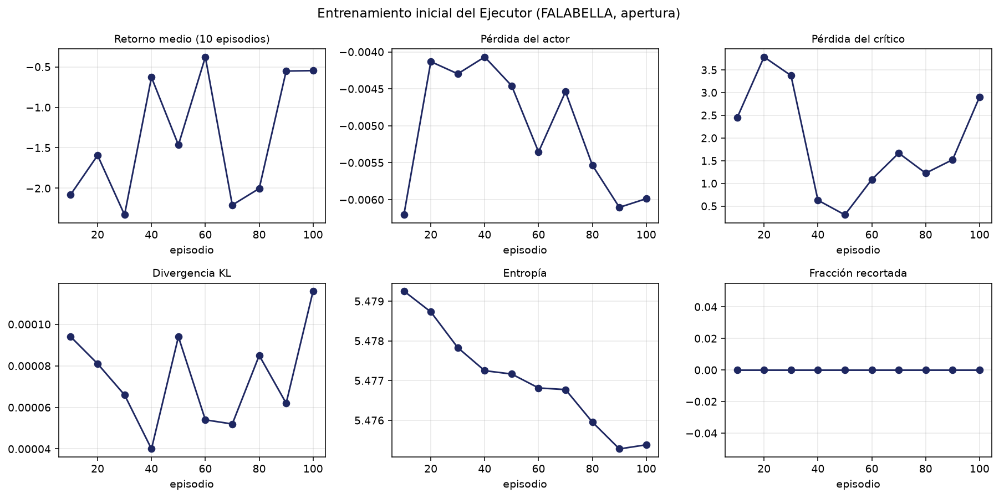

# Entrenamiento inicial de validación del Ejecutor (tarea 2.3.5)

> **Nota del 29 de octubre (revisión):** los entrenamientos en ABIDES de este documento usaron una recompensa del Ejecutor que compara el precio pagado con el precio medio de 30 segundos *después* de la compra, no con el de la decisión (falla H1 de `docs/revision_opus_PS.md`). Esa recompensa casi no se relaciona con el costo, así que lo que aquí se concluye sobre si el entrenamiento mejora el costo no debe usarse para decidir. El slippage medido, el cumplimiento y los benchmarks sí son válidos: no dependen de la recompensa.

**Responsable:** Benjamín Farias (BF). **Apoyo:** Paolo Sepúlveda (PS), Colab y análisis estadístico. **Entrenador:** Mauricio Reynoso (MR), `PPOTrainer` (2.3.2). **Estado:** **Hecho con límite demostrado**, aprobado por BF el 22 de octubre de 2026. La red entrena sin NaN, con KL estable y con un retorno que sube de forma significativa. Pero con la opción 0 de D3 la política determinista no ejecuta la orden de forma estable, y ninguna corrida se distingue de la red sin entrenar en slippage (sección 5).

> **Actualización del 2 de noviembre:** la decisión de D3 de la sección 4 (pasar a la opción A por la regla de vigilancia) **queda superada**. Esa evidencia se midió con la recompensa con falla H1. Con la recompensa corregida, la regla fijada el 29 de octubre da **D3 = 0**. También se actualiza el estado de los hallazgos para MR y de lo que pasaba al Sprint 6 (sección 11). Los resultados del 22 de octubre no cambian.

## 1. Qué se hizo

Se entrenó un Ejecutor con el entrenador PPO de MR (`PPOTrainer`, 2.3.2) durante **1000 episodios** sobre ABIDES calibrado (FALABELLA, tramo apertura, `rmsc04_ipsa_FALABELLA_2026-08-23.json`), con `q_slice` = 1000 acciones y ventana de 15 minutos. Recompensa: R_E según el Título I con β = 0,0061796 (opción 0 de D3). Semillas de entrenamiento 1001–2000; evaluación en 15 semillas nuevas (5001–5015). No se usaron las 10 meta-órdenes oficiales.

Hiperparámetros (los mismos de la fase 2 de β): γ 0,95; λ GAE 0,95; lr 3e-4; clip 0,2; entropía 0,01; coeficiente de valor 0,5; 4 épocas; minilote 64; 10 episodios por actualización.

Además de la corrida principal hay tres corridas de comparación, todas en `data/colab_resultados/`:

| Corrida | Archivos | Qué es |
|---|---|---|
| **`t5_1000ep_opcion0`** (principal) | `.json`, `.csv`, `_diagnostico.json` | 1000 episodios, opción 0 (riesgo sobre lo ejecutado) |
| `t5_1000ep_opcionA` | `.json` (sin CSV) | 1000 episodios, opción A (riesgo sobre lo pendiente), exploratoria, con el mismo β (sin recalcular β\*) |
| `t5_100ep_opcion0` | `.json`, `.csv` | 100 episodios, opción 0. Primera corrida, **reanudada desde el episodio 30** |
| `t5_100ep_opcion0_repeticion` | `.json` (sin CSV) | 100 episodios, opción 0, repetida sin cortes |

## 2. Curvas de entrenamiento (corrida principal)



- **Actualizaciones registradas:** 100 (una cada 10 episodios). **Valores no finitos (NaN o infinito) en el CSV:** 0. El checkpoint del episodio 1000 tampoco tiene parámetros no finitos (diagnóstico de PS).
- **Retorno medio:** -2,002 en el primer tercio y -1,002 en el último. **Pérdida del crítico:** 2,195 y 1,813.
- **KL máximo:** 0,00438 y mediano 0,00111. El objetivo del entrenador es 0,015; la actualización se corta si lo supera 1,5 veces.
- **Entropía:** de 5,4793 a 4,3901. Una política uniforme sobre las 240 acciones tiene 5,4806, así que la política final conserva el 80,10 % de la entropía máxima: se fue concentrando en algunas acciones.
- **Tiempo de entrenamiento:** 38,8 min.

## 3. Evaluación (15 semillas nuevas)

| Política | Slippage medio (bps) | Error estándar | Cumplimiento |
|---|---:|---:|---:|
| Red entrenada (política determinista, argmax) | — | — | 0,000 |
| Red entrenada (política muestreada, como al entrenar) | 5,43 | 5,68 | 1,000 |
| Red sin entrenar (control, argmax) | 6,02 | 4,68 | 1,000 |
| Referencia: agresiva_market | 10,45 | 4,39 | 1,000 |
| Referencia: twap_limit_medio | 1,78 | 4,58 | 0,971 |
| Referencia: pasiva_limit | 7,88 | 4,69 | 1,000 |

Comparación pareada por semilla (red entrenada con política muestreada menos cada alternativa; negativo = la red entrenada tiene menos slippage):

| Contra | Diferencia media (bps) | Error estándar | p (Wilcoxon) |
|---|---:|---:|---:|
| Red sin entrenar (control) | -0,58 | 4,68 | 0,679 |
| Referencia: agresiva_market | -5,02 | 5,09 | 0,121 |
| Referencia: twap_limit_medio | 3,66 | 2,47 | 0,277 |
| Referencia: pasiva_limit | -2,44 | 2,92 | 0,208 |

### Diagnóstico de la política (checkpoint del episodio 1000)

Tres episodios de evaluación; `scripts/colab/diagnostico_politica_entrenada_ps.py` imprime las acciones paso a paso.

| Modo | Cumplimiento medio | Acciones más usadas (todas las semillas) |
|---|---:|---|
| determinista | 0,000 | `LIMIT_SELL / bucket5 / nivel4` ×89, `LIMIT_SELL / bucket3 / nivel0` ×1 |
| estocástico | 0,997 | `LIMIT_SELL / bucket5 / nivel4` ×11, `LIMIT_SELL / bucket3 / nivel0` ×10, `LIMIT_SELL / bucket8 / nivel1` ×6 |

**Por qué el argmax no ejecuta.** El espacio de acciones del Ejecutor es `MultiDiscrete([3, 10, 8])` = 240 acciones (tipo de orden × bucket de volumen × nivel de precio), con tipos `LIMIT_BUY`, `LIMIT_SELL` y `MARKET`. El proyecto solo modela compra, y el puente de ABIDES traduce **las 80 acciones `LIMIT_SELL` (un tercio del espacio) a «esperar»**: no envía ninguna orden (`src/envs/abides_bridge.py:170`, `if size <= 0 or order_type == ORDER_LIMIT_SELL: return []`). Ninguna otra acción queda vacía mientras haya inventario pendiente: el tamaño es al menos 1 acción. Con la opción 0, esperar no tiene costo en R_E y la red concentró el argmax en una de esas acciones. Muestreando, la masa que queda en las demás acciones alcanza para completar la orden. El conteo lo hace `scripts/criterios_convergencia_2_3_5.py` con el puente real, y lo fija un test.

### Comparación de corridas

Misma evaluación (15 semillas nuevas, FALABELLA, apertura). Slippage en bps, con el error estándar entre paréntesis; la diferencia es contra la red sin entrenar, pareada por semilla.

| Corrida | Episodios | Riesgo sobre | Argmax: cumplimiento | Argmax: slippage | Argmax: dif. vs control | Muestreada: cumplimiento | Muestreada: slippage | Muestreada: dif. vs control |
|---|---:|---|---:|---|---|---:|---|---|
| Principal (opción 0) | 1000 | ejecutado | 0,000 | sin ejecuciones | — | 1,000 | 5,43 (5,68) | -0,58 (p = 0,679) |
| Opción A de D3 | 1000 | pendiente | 1,000 | 5,91 (3,21) | -0,10 (p = 0,524) | 1,000 | 4,60 (3,06) | -1,42 (p = 0,804) |
| 100 episodios, opción 0 (primera, reanudada desde el episodio 30) | 100 | ejecutado | 1,000 | 3,28 (2,45) | -2,74 (p = 0,762) | — | — | — |
| 100 episodios, opción 0 (repetición sin cortes) | 100 | ejecutado | 0,904 | 2,04 (4,11) | -3,97 (p = 0,359) | 1,000 | 2,71 (2,80) | -3,31 (p = 0,720) |

## 4. Regla de vigilancia de D3

La regla se fijó antes de ver datos (`docs/decision_RE_para_BF.md`): si en la 2.3.5 el cumplimiento de la orden baja del 95 %, se pasa a la opción A (riesgo sobre lo pendiente).

- Con la opción 0, el cumplimiento con argmax fue **0,000** (1000 episodios), **1,000** (100 episodios, primera) y **0,904** (100 episodios, repetición): **2 de 3 corridas quedan bajo el 95 %**. Las dos corridas sin cortes quedan ambas bajo el umbral. La de 1,000 es la que se reanudó desde un checkpoint y no es reproducible (sección 6).
- **Decisión de BF (revisión final de D3):** se activa la opción A por la regla de vigilancia. Es una desviación del Título I justificada con datos. Recalcular β\* (PS) y reentrenar con la opción A pasan al Sprint 6 (sección 8).
- *Superado el 2 de noviembre: ver la sección 11.*

## 5. Lectura de BF

### Criterios de convergencia (fijados antes de correr), corrida principal

Calculados con `scripts/criterios_convergencia_2_3_5.py` (lógica en `src/experiments/criterios_2_3_5.py`), que escribe `data/analysis/criterios_2.3.5.json`.

| Criterio | Valor | ¿Cumple? |
|---|---|:---:|
| 1. Sin NaN | 0 valores no finitos en 100 actualizaciones (checkpoint sin parámetros no finitos) | **cumple** |
| 2. Retorno final > inicial (Mann-Whitney unilateral, α 0,05, primeras 10 contra últimas 10 actualizaciones) | -1,931 → -1,131; U = 80; p = 0,013 | **cumple** |
| 3. KL mediano < 0,015 | 0,00111 (máximo 0,00438) | **cumple** |
| 4. Cumplimiento medio ≥ 95 % (argmax, regla de D3) | 0,000 | **no cumple** |
| 5. Menos slippage que la TWAP heurística (Wilcoxon pareado, mismas semillas) | No evaluable con argmax: la red no ejecutó en 15 de 15 semillas. Con la política muestreada: +3,66 bps (EE 2,47), p = 0,277 | **no cumple** |

**3 de 5 criterios se cumplen.** Los que fallan son los de resultado (cumplimiento y slippage), no los de estabilidad del entrenamiento.

### Los mismos criterios en las corridas de comparación

| Corrida | 1. Sin NaN | 2. Retorno sube | 3. KL mediano | 4. Cumplimiento argmax | 5. Slippage vs TWAP (argmax) |
|---|---|---|---|---|---|
| Opción A, 1000 ep | sin CSV | sin CSV | sin CSV | 1,000 · cumple | +4,13 bps, p = 0,208 · no cumple |
| 100 ep, primera (reanudada) | 0 · cumple | no evaluable (10 actualizaciones) | 0,000073 · cumple | 1,000 · cumple | +1,50 bps, p = 0,421 · no cumple |
| 100 ep, repetición | sin CSV | sin CSV | sin CSV | 0,904 · no cumple | +0,26 bps, p = 0,847 · no cumple |

En ninguna corrida la red tiene menos slippage que la TWAP heurística: la diferencia es positiva en todas.

### Lectura

- **El entrenamiento es estable.** Sin NaN, KL muy por debajo del objetivo y un retorno medio que sube de forma significativa entre el principio y el final (p = 0,013). El ciclo completo (entrenador de MR, ABIDES calibrado, checkpoint, CSV y evaluación en semillas nuevas) funciona.
- **Con la opción 0, la política determinista no ejecuta de forma estable.** El argmax cae en una acción `LIMIT_SELL`, que el puente traduce a esperar, y con la opción 0 esperar no cuesta nada en R_E. El cumplimiento con argmax fue 0,000 / 1,000 / 0,904 en 3 corridas: depende del azar del entrenamiento. Por la regla de D3, corresponde pasar a la opción A.
- **Con la opción A, el argmax sí ejecuta** (cumplimiento 1,000 en la corrida exploratoria): penalizar lo pendiente evita que la red aprenda a esperar. Fue una sola corrida, con el β de la opción 0 sin recalcular.
- **Ninguna corrida se distingue de la red sin entrenar en slippage** (diferencias de -0,10 a -3,97 bps, todas con p ≥ 0,35), y ninguna supera a la TWAP heurística. Con 15 semillas y una sola red por corrida no se puede afirmar que entrenar mejore el costo.
- Que el retorno de entrenamiento suba sin que mejore el slippage de evaluación es coherente con lo anterior: con la opción 0, la red aprende a evitar el término de riesgo (que solo cobra al ejecutar), no a ejecutar mejor.

## 6. Desviaciones

1. **Evaluación con 15 semillas en vez de 30.** Por costo de Colab, igual que P5. El error estándar (2–6 bps) es grande frente a las diferencias entre políticas.
2. **Mann-Whitney sobre actualizaciones.** El criterio original comparaba los primeros 20 episodios con los últimos 20. El CSV del entrenador trae `reward_mean` por actualización (10 episodios cada una), no por episodio, así que se comparan las primeras 10 actualizaciones con las últimas 10 (100 episodios en cada grupo). Para las corridas de 100 episodios (10 actualizaciones) el criterio no se puede evaluar.
3. **1000 episodios en la corrida principal.** El plan pedía 100. Se hicieron ambas, y los criterios se aplican a la de 1000 porque es la única con suficientes actualizaciones para el criterio 2.
4. **Criterio 5 con la política determinista**, la misma de la regla de D3. Como la red no ejecutó, se informa además la política muestreada. El Wilcoxon es bilateral, el mismo cálculo del informe de PS. Como la diferencia es positiva en todas las corridas, el veredicto no cambia si se usa la prueba unilateral.
5. **Opción A probada sin recalcular β\*.** La corrida `t5_1000ep_opcionA` usó el β de la opción 0. El plan pide recalcular β\* y repetir la fase 2 si se adopta la opción A (sección 8).
6. **Responsable de β\*.** La ficha P2 del plan decía «BF recalcula β\*». Se acuerda que lo recalcula PS (está en su plan del Sprint 6) y BF decide.

## 7. Hallazgos para MR

**(a) `save_checkpoint` no guarda el estado de los generadores aleatorios, y por eso reanudar cambia los resultados.**

- **Qué guarda y qué no.** El checkpoint guarda pesos, optimizador, episodio, configuración y semilla (`src/training/ppo_trainer.py:283-299`). No guarda el estado de torch (`torch.get_rng_state()`), de numpy (`np.random.get_state()`, que usa `RolloutBuffer.get_batches` en la línea 113) ni de `random`.
- **Qué pasa al reanudar.** Se crea un `PPOTrainer(seed=…)` nuevo, que vuelve a sembrar con la semilla inicial (líneas 152 y 177-179). Desde ese punto, el muestreo de acciones y los minilotes repiten la secuencia del episodio 0, no la que seguía.
- **Evidencia.** La primera corrida de 100 episodios se reanudó en el episodio 30. Su CSV coincide con el de la corrida de 1000 episodios hasta el episodio 30 y se separa desde el 40 (retorno -0,629 contra -4,129). La repetición sin cortes coincide con la de 1000 en todas las actualizaciones (PS).
- **El test no lo detecta.** La ficha T2 pedía «un checkpoint reanuda sin cambiar el resultado». `test_checkpoint_y_reanudacion` (`tests/test_ppo_trainer.py:92`) solo comprueba el contador de episodios.
- **Propuesta (no implementada, el archivo es de MR):** guardar los tres estados en `save_checkpoint`, restaurarlos en `load_checkpoint` y agregar un test que compare entrenar 4+2 episodios con reanudación contra 6 seguidos.

**(b) El espacio de acciones incluye acciones que no hacen nada.**

- **Qué pasa.** 80 de las 240 acciones (todas las `LIMIT_SELL`) se traducen a `[]` en `map_action_to_abides_orders` (`src/envs/abides_bridge.py:170`). Con la red sin entrenar, un tercio de la probabilidad está en «esperar». Con la opción 0, esperar es gratis, y el argmax de la política entrenada terminó en `LIMIT_SELL / bucket5 / nivel4`.
- **Propuesta para decidir en el Sprint 6 (MR, con BF):**
  - enmascarar los logits de `LIMIT_SELL` en el Ejecutor;
  - o reducir el espacio a compra (160 acciones);
  - o mantenerlo y declarar «esperar» como acción explícita, con una sola entrada en vez de 80.
- **Qué afecta.** Toca `src/models/actor_critic.py` y el puente, que son de MR. No se cambia en este sprint.

## 8. Pasa al Sprint 6

- **Evaluación con 30 semillas** (en vez de 15) para las corridas que se comparen.
- **Opción A con β\* recalculado por PS** (barrido y fase 2 con `riesgo_sobre="pendiente"`) y reentrenamiento del Ejecutor con ese β.
  - Costo medido: fase 2 en apertura ≈ 1–2 h de Colab; ~47 min por β en media jornada y ~108 min en el cierre; un entrenamiento de 1000 episodios ≈ 31–39 min.
- **Varias redes por configuración** (al menos 3 semillas de entrenamiento), para que la regla de D3 y la comparación de slippage no dependan de una sola red.
- **Hallazgos para MR** (sección 7): estado de los generadores aleatorios en el checkpoint y decisión sobre las acciones `LIMIT_SELL`.

## 9. Limitaciones

- Entrenamiento corto (100 a 1000 episodios) y una sola red por corrida: el resultado es indicativo, no concluyente.
- Solo FALABELLA y un tramo; no incluye a COPEC ni a ECL.
- La evaluación usa 15 semillas: el error estándar es grande frente a las diferencias entre políticas.
- La opción A y la repetición de 100 episodios no tienen CSV versionado: sus criterios de curva (1 a 3) no se pueden evaluar.
- **Reproducibilidad:** con las mismas semillas, un entrenamiento sin cortes da curvas idénticas. Si se interrumpe y se reanuda desde un checkpoint, los resultados cambian (sección 7a).

## 10. Cómo reproducir

En Colab, con el entorno preparado (`docs/dependencias_resueltas.md`, con `torch==1.13.1+cpu`):

```bash
PYTHONPATH=. python scripts/colab/entrenamiento_inicial_ps.py \
    --calibrated-json data/calibration/rmsc04_ipsa_FALABELLA_2026-08-23.json --out-dir <carpeta_de_drive>/t5_entrenamiento \
    --tramo apertura --episodes 1000 --ventana-min 15 --max-minutes 150
```

El script es reanudable, pero reanudar cambia los resultados (sección 7a). En local, sin Colab:

```bash
python scripts/criterios_convergencia_2_3_5.py      # tabla de criterios (sección 5) -> data/analysis/criterios_2.3.5.json
python -m pytest tests/test_criterios_2_3_5.py -q
```

`scripts/analizar_entrenamiento_inicial.py` genera el borrador de PS (secciones 1 a 3 y la figura). Si se corre con la ruta por defecto de `--out-md`, **sobrescribe este documento aprobado**: usar otra ruta.

## 11. Actualización del 2 de noviembre de 2026

Esta sección agrega información. Las secciones 1 a 10 quedan tal como se aprobaron el 22 de octubre.

### D3: la decisión del 22 de octubre queda superada

- **Qué se decidió el 22 de octubre:** pasar a la opción A, porque con la opción 0 el cumplimiento con argmax fue 0,000 / 1,000 / 0,904 y la regla de vigilancia del 95 % se disparaba (sección 4).
- **Por qué ya no vale:** esa evidencia se midió con la recompensa con falla H1 (`docs/revision_opus_PS.md`). La recompensa comparaba el precio pagado con el precio medio de 30 s después de la compra, no con el de la decisión. El propio documento de D3 dice que esa evidencia no sirve para decidir (`docs/decision_RE_final_D3_para_BF.md`, nota del 29 de octubre).
- **Regla nueva, fijada el 29 de octubre antes de ver los datos corregidos** (`docs/revision_opus_PS.md`, sección 6). Se queda la opción 0 salvo que la A cumpla dos condiciones:
  - (a) completar la orden con argmax en más redes;
  - (b) que el límite superior del IC 95 % de A − 0 sea menor que +1 bps.
- **Resultado con la recompensa corregida** (`notebooks/Colab_mid_decision_A/B`, semillas de red 1000 y 2000, reevaluación pareada en 300 semillas; `docs/reeval_300_mid_resultado_PS.md`, sección 5):

| Comparación (misma semilla de red) | A − 0 (bps), IC 95 % |
|---|---|
| Semilla 1000 | −1,79 [−2,50; −1,12] |
| Semilla 2000 | +0,60 [−0,06; +1,25] |
| Las dos juntas | **−0,60 [−1,04; −0,16]** |

  - La condición (a) **no se cumple**: las dos opciones completan el 100 % con argmax.
  - La condición (b) sí se cumple. Como hacen falta las dos, la regla da **D3 = 0** (fórmula del Título I).
- **Contexto del costo:** con la recompensa corregida, las dos opciones cuestan más que su red sin entrenar:
  - opción 0: +1,55 bps [+0,37; +2,71];
  - opción A: +0,57 bps [−0,70; +1,78].
- **El Ejecutor del sistema final está entrenado con la opción 0:** `rimit__d3_opcion0_s1000`, 5,68 bps en 300 semillas, cumplimiento 1,000 (`docs/sistema_final_resultado_PS.md`).
- La respuesta formal de BF queda en `docs/hoja_decisiones_D1_D3_BF.md`.
- **Qué se declara:** la regla de vigilancia original se aplicó el 22 de octubre, pero sobre evidencia inválida (H1). Se reemplazó por una regla fijada antes de ver los datos corregidos (R6).

### Estado de los hallazgos para MR (sección 7)

**(a) Checkpoint sin el estado de los generadores aleatorios: resuelto en el Sprint 6.**
- Lo resolvió un borrador de PS para MR (`fad3ab1`, que llegó a `main` con el PR #44).
- En `src/training/ppo_trainer.py` de `main`:
  - `_estado_aleatorio` (líneas 55–62) guarda los estados de torch (`torch.get_rng_state()`), numpy (`np.random.get_state()`) y `random` (`random.getstate()`);
  - `_restaurar_estado_aleatorio` (líneas 65–70) los repone;
  - `save_checkpoint` los escribe en `rng_state` (línea 320);
  - `load_checkpoint` los restaura (líneas 336–338). Los checkpoints anteriores, que no traen `rng_state`, cargan igual.
- Lo fija `test_reanudar_desde_checkpoint_da_lo_mismo_que_no_cortar` (`tests/test_maestro_trainer.py:39`). El test entrena un `PPOTrainer` del Ejecutor seguido y otro cortado y reanudado, y exige pesos idénticos.
- Falta la revisión formal de MR, porque el archivo es suyo.
- `test_checkpoint_y_reanudacion` (`tests/test_ppo_trainer.py:92`) sigue comprobando solo el contador de episodios.

**(b) Acciones del Ejecutor que no hacen nada: sigue abierto.**
- En `main`, `map_action_to_abides_orders` sigue traduciendo las 80 acciones `LIMIT_SELL` a `[]` (`src/envs/abides_bridge.py:170`).
- Nadie enmascaró los logits ni redujo el espacio: el último cambio en `src/models/` es del 18 de octubre (`62d6a87`).
- Lo que se hizo en el Sprint 6 solo lo mitiga:
  - la penalización por lo no comprado, que hace que esperar cueste (desviación 6);
  - la métrica `pct_espera` del monitoreo, que avisa cuando una red se queda esperando (`src/training/monitoreo.py:122`);
  - la observación H6 de `docs/revision_opus_PS.md`: de las 240 acciones, solo 91 son distintas en la práctica.
- La decisión sigue siendo de MR, con BF.

### Qué se hizo de lo que pasaba al Sprint 6 (sección 8)

| Pendiente | Estado | Dónde |
|---|---|---|
| Evaluación con 30 semillas | **Hecho y ampliado a 300 semillas** de evaluación (5001–5300) | `docs/reeval_300_resultado_PS.md`, `docs/reeval_300_mid_resultado_PS.md`, `docs/reeval_300_imitacion_resultado_PS.md` |
| Varias redes por configuración | **Hecho.** Barrido 3.1.1/3.1.2 con 2 redes por configuración en Poisson (36 configuraciones y 72 redes; 25 combinaciones y 50 redes). En ABIDES: 5 redes por opción de D3 con 100 episodios, 3 por opción con 1.000 episodios y 4 + 2 redes con la recompensa corregida | `docs/barrido_hiperparametros_resultado_PS.md`, `docs/estabilidad_D3_PS.md`, `docs/estabilidad_D3_1000ep_PS.md`, `docs/reeval_300_mid_resultado_PS.md` |
| Opción A con β\* recalculado y reentrenamiento | **Ya no aplica:** D3 = 0. β = 0,0061796 se mantiene. Tampoco se revalida β con la recompensa corregida (H5), porque `mid_decision` no quedó por defecto | `docs/revision_opus_PS.md`, sección 0 |
| Hallazgos para MR | (a) resuelto; (b) abierto | Esta sección |

---

Borrador de PS con apoyo de Claude Code; revisado, completado y aprobado por BF con apoyo de Claude Code.
