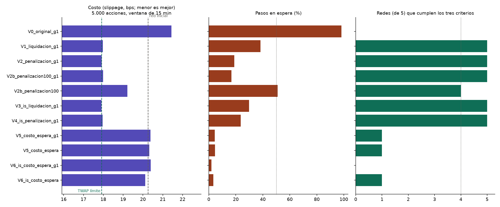

# Experimentos de recompensa, etapa A2

**Elaborado por:** PS con apoyo de Claude Code (uso autorizado por la universidad). **Pendiente de revisión por:** BF (R_E) y MR (entrenamiento). Simulador de Poisson en el PC; 1.000 episodios por red y 5 semillas de red por variante; evaluación con 50 semillas nuevas.

Criterio para dar por buena una red (escenario de 5.000 acciones, política muestreada): (1) cumple la orden por su cuenta (≥ 90 % voluntario), (2) no se queda esperando (≤ 50 % de los pasos) y (3) cuesta menos que su propia red inicial (Wilcoxon pareado, p < 0,05). Una variante funciona si 4 de 5 redes lo cumplen.

## 1. Qué cambia en cada variante

| Variante | Qué cambia |
|---|---|
| V0_original_g1 | recompensa original |
| V1_liquidacion_g1 | recompensa original, liquidación forzada al final |
| V2_penalizacion_g1 | recompensa original, penalización 30 bps por acción pendiente |
| V2b_penalizacion100_g1 | recompensa original, penalización 100 bps por acción pendiente |
| V2b_penalizacion100 | recompensa original, penalización 100 bps por acción pendiente |
| V3_is_liquidacion_g1 | recompensa is_llegada, liquidación forzada al final |
| V4_is_penalizacion_g1 | recompensa is_llegada, penalización 30 bps por acción pendiente |
| V5_costo_espera_g1 | recompensa original, costo de espera 100 bps repartido en la ventana |
| V5_costo_espera | recompensa original, costo de espera 100 bps repartido en la ventana |
| V6_is_costo_espera_g1 | recompensa is_llegada, costo de espera 100 bps repartido en la ventana |
| V6_is_costo_espera | recompensa is_llegada, costo de espera 100 bps repartido en la ventana |

## 2. Resultado por escenario (promedio de las 5 redes, política muestreada)

### 1.000 acciones, 15 min

| Variante | Slippage (bps) | Red inicial (bps) | Cumplimiento voluntario | Pasos en espera |
|---|---:|---:|---:|---:|
| V0_original_g1 | 18,82 | 17,87 | 0,08 | 98 % |
| V1_liquidacion_g1 | 17,83 | 17,87 | 0,94 | 38 % |
| V2_penalizacion_g1 | 17,75 | 17,87 | 0,99 | 19 % |
| V2b_penalizacion100_g1 | 17,74 | 17,87 | 1,00 | 17 % |
| V2b_penalizacion100 | 17,86 | 17,87 | 0,96 | 49 % |
| V3_is_liquidacion_g1 | 17,75 | 17,87 | 0,99 | 30 % |
| V4_is_penalizacion_g1 | 17,75 | 17,87 | 1,00 | 24 % |
| V5_costo_espera_g1 | 17,70 | 17,87 | 1,00 | 5 % |
| V5_costo_espera | 17,74 | 17,87 | 1,00 | 5 % |
| V6_is_costo_espera_g1 | 17,69 | 17,87 | 1,00 | 2 % |
| V6_is_costo_espera | 17,65 | 17,87 | 1,00 | 4 % |
| *Referencia: TWAP con órdenes límite* | 17,90 | — | 0,98 | 0 % |
| *Referencia: mercado agresiva* | 18,27 | — | 1,00 | 0 % |
| *Referencia: esperar siempre* | 18,96 | — | 0,00 | 100 % |

### 5.000 acciones, 15 min

| Variante | Slippage (bps) | Red inicial (bps) | Cumplimiento voluntario | Pasos en espera |
|---|---:|---:|---:|---:|
| V0_original_g1 | 21,44 | 20,26 | 0,05 | 98 % |
| V1_liquidacion_g1 | 17,97 | 20,26 | 0,95 | 38 % |
| V2_penalizacion_g1 | 17,92 | 20,26 | 0,99 | 19 % |
| V2b_penalizacion100_g1 | 17,98 | 20,26 | 1,00 | 17 % |
| V2b_penalizacion100 | 19,21 | 20,26 | 0,95 | 51 % |
| V3_is_liquidacion_g1 | 17,91 | 20,26 | 0,99 | 30 % |
| V4_is_penalizacion_g1 | 17,96 | 20,26 | 1,00 | 24 % |
| V5_costo_espera_g1 | 20,38 | 20,26 | 1,00 | 4 % |
| V5_costo_espera | 20,32 | 20,26 | 1,00 | 5 % |
| V6_is_costo_espera_g1 | 20,39 | 20,26 | 1,00 | 2 % |
| V6_is_costo_espera | 20,11 | 20,26 | 1,00 | 3 % |
| *Referencia: TWAP con órdenes límite* | 17,91 | — | 0,98 | 0 % |
| *Referencia: mercado agresiva* | 20,93 | — | 1,00 | 0 % |
| *Referencia: esperar siempre* | 21,53 | — | 0,00 | 100 % |

### 20.000 acciones, 15 min

| Variante | Slippage (bps) | Red inicial (bps) | Cumplimiento voluntario | Pasos en espera |
|---|---:|---:|---:|---:|
| V0_original_g1 | 21,93 | 21,13 | 0,01 | 99 % |
| V1_liquidacion_g1 | 19,90 | 21,13 | 0,92 | 37 % |
| V2_penalizacion_g1 | 19,68 | 21,13 | 0,99 | 18 % |
| V2b_penalizacion100_g1 | 20,31 | 21,13 | 0,99 | 16 % |
| V2b_penalizacion100 | 21,02 | 21,13 | 0,76 | 53 % |
| V3_is_liquidacion_g1 | 19,98 | 21,13 | 0,98 | 28 % |
| V4_is_penalizacion_g1 | 20,02 | 21,13 | 0,99 | 22 % |
| V5_costo_espera_g1 | 21,35 | 21,13 | 1,00 | 3 % |
| V5_costo_espera | 21,34 | 21,13 | 1,00 | 3 % |
| V6_is_costo_espera_g1 | 21,37 | 21,13 | 1,00 | 1 % |
| V6_is_costo_espera | 21,34 | 21,13 | 1,00 | 2 % |
| *Referencia: TWAP con órdenes límite* | 19,31 | — | 0,96 | 0 % |
| *Referencia: mercado agresiva* | 21,45 | — | 1,00 | 0 % |
| *Referencia: esperar siempre* | 21,97 | — | 0,00 | 100 % |

## 3. Criterio por variante

| Variante | Redes que cumplen la orden | Redes que no esperan | Redes que bajan el costo | **Redes que cumplen los tres** | Diferencia media frente a la red inicial (bps) | ¿Funciona? |
|---|---:|---:|---:|---:|---:|:---:|
| V0_original_g1 | 0 de 5 | 0 de 5 | 0 de 5 | **0 de 5** | 1,18 | no |
| V1_liquidacion_g1 | 5 de 5 | 5 de 5 | 5 de 5 | **5 de 5** | -2,29 | sí |
| V2_penalizacion_g1 | 5 de 5 | 5 de 5 | 5 de 5 | **5 de 5** | -2,35 | sí |
| V2b_penalizacion100_g1 | 5 de 5 | 5 de 5 | 5 de 5 | **5 de 5** | -2,28 | sí |
| V2b_penalizacion100 | 4 de 5 | 4 de 5 | 4 de 5 | **4 de 5** | -1,05 | sí |
| V3_is_liquidacion_g1 | 5 de 5 | 5 de 5 | 5 de 5 | **5 de 5** | -2,35 | sí |
| V4_is_penalizacion_g1 | 5 de 5 | 5 de 5 | 5 de 5 | **5 de 5** | -2,30 | sí |
| V5_costo_espera_g1 | 5 de 5 | 5 de 5 | 1 de 5 | **1 de 5** | 0,12 | no |
| V5_costo_espera | 5 de 5 | 5 de 5 | 1 de 5 | **1 de 5** | 0,06 | no |
| V6_is_costo_espera_g1 | 5 de 5 | 5 de 5 | 0 de 5 | **0 de 5** | 0,13 | no |
| V6_is_costo_espera | 5 de 5 | 5 de 5 | 1 de 5 | **1 de 5** | -0,15 | no |

### Redes que cumplen los tres criterios en cada escenario de evaluación

| Variante | 1.000 acciones | 5.000 acciones | 20.000 acciones |
|---|---:|---:|---:|
| V0_original_g1 | 0 de 5 | 0 de 5 | 0 de 5 |
| V1_liquidacion_g1 | 0 de 5 | 5 de 5 | 4 de 5 |
| V2_penalizacion_g1 | 0 de 5 | 5 de 5 | 5 de 5 |
| V2b_penalizacion100_g1 | 0 de 5 | 5 de 5 | 5 de 5 |
| V2b_penalizacion100 | 0 de 5 | 4 de 5 | 0 de 5 |
| V3_is_liquidacion_g1 | 0 de 5 | 5 de 5 | 5 de 5 |
| V4_is_penalizacion_g1 | 0 de 5 | 5 de 5 | 5 de 5 |
| V5_costo_espera_g1 | 3 de 5 | 1 de 5 | 0 de 5 |
| V5_costo_espera | 3 de 5 | 1 de 5 | 0 de 5 |
| V6_is_costo_espera_g1 | 2 de 5 | 0 de 5 | 0 de 5 |
| V6_is_costo_espera | 5 de 5 | 1 de 5 | 0 de 5 |

## 4. Qué pasó durante el entrenamiento (primer y último bloque de 100 episodios)

| Variante | Recompensa | Pasos en espera | Órdenes de mercado | Órdenes límite | Slippage (bps) |
|---|---|---|---|---|---|
| V0_original_g1 | -11,72 → -0,42 | 31 % → 98 % | 36 % → 0 % | 33 % → 2 % | 20,1 → 19,9 |
| V1_liquidacion_g1 | -11,71 → -10,40 | 32 % → 38 % | 36 % → 44 % | 33 % → 18 % | 20,1 → 18,0 |
| V2_penalizacion_g1 | -11,71 → -10,43 | 32 % → 19 % | 36 % → 39 % | 33 % → 42 % | 20,1 → 17,9 |
| V2b_penalizacion100_g1 | -11,71 → -10,53 | 32 % → 18 % | 36 % → 48 % | 33 % → 35 % | 20,1 → 18,0 |
| V2b_penalizacion100 | -11,70 → -13,73 | 32 % → 51 % | 35 % → 17 % | 33 % → 32 % | 20,1 → 19,4 |
| V3_is_liquidacion_g1 | -11,67 → -10,40 | 32 % → 30 % | 36 % → 38 % | 33 % → 31 % | 20,1 → 17,9 |
| V4_is_penalizacion_g1 | -11,67 → -10,46 | 32 % → 24 % | 36 % → 49 % | 33 % → 27 % | 20,1 → 18,0 |
| V5_costo_espera_g1 | -18,36 → -13,72 | 30 % → 4 % | 37 % → 76 % | 33 % → 20 % | 20,1 → 20,4 |
| V5_costo_espera | -18,25 → -13,76 | 31 % → 5 % | 37 % → 84 % | 32 % → 10 % | 20,2 → 20,3 |
| V6_is_costo_espera_g1 | -18,44 → -13,50 | 31 % → 3 % | 37 % → 88 % | 32 % → 9 % | 20,1 → 20,4 |
| V6_is_costo_espera | -18,25 → -13,50 | 31 % → 4 % | 37 % → 88 % | 32 % → 8 % | 20,1 → 20,1 |

**Mejor variante según el criterio:** `V3_is_liquidacion_g1` (5 de 5 redes cumplen los tres puntos).

🤖 Generado con [Claude Code](https://claude.com/claude-code)
