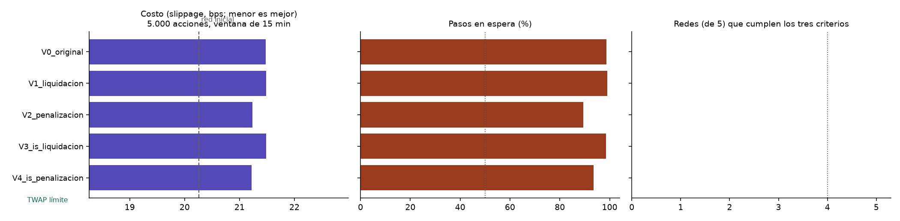

# Experimentos de recompensa, etapa A

**Elaborado por:** PS con apoyo de Claude Code (uso autorizado por la universidad). **Pendiente de revisión por:** BF (R_E) y MR (entrenamiento). Simulador de Poisson en el PC; 1.000 episodios por red y 5 semillas de red por variante; evaluación con 50 semillas nuevas.

Criterio para dar por buena una red (escenario de 5.000 acciones, política muestreada): (1) cumple la orden por su cuenta (≥ 90 % voluntario), (2) no se queda esperando (≤ 50 % de los pasos) y (3) cuesta menos que su propia red inicial (Wilcoxon pareado, p < 0,05). Una variante funciona si 4 de 5 redes lo cumplen.

## 1. Qué cambia en cada variante

| Variante | Qué cambia |
|---|---|
| V0_original | recompensa original |
| V1_liquidacion | recompensa original, liquidación forzada al final |
| V2_penalizacion | recompensa original, penalización 30 bps por acción pendiente |
| V3_is_liquidacion | recompensa is_llegada, liquidación forzada al final |
| V4_is_penalizacion | recompensa is_llegada, penalización 30 bps por acción pendiente |

## 2. Resultado por escenario (promedio de las 5 redes, política muestreada)

### 1.000 acciones, 15 min

| Variante | Slippage (bps) | Red inicial (bps) | Cumplimiento voluntario | Pasos en espera |
|---|---:|---:|---:|---:|
| V0_original | 18,84 | 17,87 | 0,08 | 99 % |
| V1_liquidacion | 18,88 | 17,87 | 0,05 | 99 % |
| V2_penalizacion | 18,75 | 17,87 | 0,17 | 89 % |
| V3_is_liquidacion | 18,82 | 17,87 | 0,06 | 98 % |
| V4_is_penalizacion | 18,69 | 17,87 | 0,13 | 93 % |
| *Referencia: TWAP con órdenes límite* | 17,90 | — | 0,98 | 0 % |
| *Referencia: mercado agresiva* | 18,27 | — | 1,00 | 0 % |
| *Referencia: esperar siempre* | 18,96 | — | 0,00 | 100 % |

### 5.000 acciones, 15 min

| Variante | Slippage (bps) | Red inicial (bps) | Cumplimiento voluntario | Pasos en espera |
|---|---:|---:|---:|---:|
| V0_original | 21,48 | 20,26 | 0,05 | 99 % |
| V1_liquidacion | 21,48 | 20,26 | 0,03 | 99 % |
| V2_penalizacion | 21,24 | 20,26 | 0,14 | 89 % |
| V3_is_liquidacion | 21,49 | 20,26 | 0,04 | 99 % |
| V4_is_penalizacion | 21,22 | 20,26 | 0,11 | 93 % |
| *Referencia: TWAP con órdenes límite* | 17,91 | — | 0,98 | 0 % |
| *Referencia: mercado agresiva* | 20,93 | — | 1,00 | 0 % |
| *Referencia: esperar siempre* | 21,53 | — | 0,00 | 100 % |

### 20.000 acciones, 15 min

| Variante | Slippage (bps) | Red inicial (bps) | Cumplimiento voluntario | Pasos en espera |
|---|---:|---:|---:|---:|
| V0_original | 21,95 | 21,13 | 0,01 | 99 % |
| V1_liquidacion | 21,94 | 21,13 | 0,01 | 99 % |
| V2_penalizacion | 21,79 | 21,13 | 0,11 | 89 % |
| V3_is_liquidacion | 21,95 | 21,13 | 0,01 | 99 % |
| V4_is_penalizacion | 21,91 | 21,13 | 0,05 | 95 % |
| *Referencia: TWAP con órdenes límite* | 19,31 | — | 0,96 | 0 % |
| *Referencia: mercado agresiva* | 21,45 | — | 1,00 | 0 % |
| *Referencia: esperar siempre* | 21,97 | — | 0,00 | 100 % |

## 3. Criterio por variante

| Variante | Redes que cumplen la orden | Redes que no esperan | Redes que bajan el costo | **Redes que cumplen los tres** | Diferencia media frente a la red inicial (bps) | ¿Funciona? |
|---|---:|---:|---:|---:|---:|:---:|
| V0_original | 0 de 5 | 0 de 5 | 0 de 5 | **0 de 5** | 1,22 | no |
| V1_liquidacion | 0 de 5 | 0 de 5 | 0 de 5 | **0 de 5** | 1,22 | no |
| V2_penalizacion | 0 de 5 | 0 de 5 | 0 de 5 | **0 de 5** | 0,97 | no |
| V3_is_liquidacion | 0 de 5 | 0 de 5 | 0 de 5 | **0 de 5** | 1,22 | no |
| V4_is_penalizacion | 0 de 5 | 0 de 5 | 0 de 5 | **0 de 5** | 0,96 | no |

### Redes que cumplen los tres criterios en cada escenario de evaluación

| Variante | 1.000 acciones | 5.000 acciones | 20.000 acciones |
|---|---:|---:|---:|
| V0_original | 0 de 5 | 0 de 5 | 0 de 5 |
| V1_liquidacion | 0 de 5 | 0 de 5 | 0 de 5 |
| V2_penalizacion | 0 de 5 | 0 de 5 | 0 de 5 |
| V3_is_liquidacion | 0 de 5 | 0 de 5 | 0 de 5 |
| V4_is_penalizacion | 0 de 5 | 0 de 5 | 0 de 5 |

## 4. Qué pasó durante el entrenamiento (primer y último bloque de 100 episodios)

| Variante | Recompensa | Pasos en espera | Órdenes de mercado | Órdenes límite | Slippage (bps) |
|---|---|---|---|---|---|
| V0_original | -11,70 → -0,33 | 32 % → 98 % | 35 % → 0 % | 33 % → 2 % | 20,1 → 20,3 |
| V1_liquidacion | -11,70 → -12,15 | 32 % → 99 % | 35 % → 0 % | 33 % → 1 % | 20,1 → 21,6 |
| V2_penalizacion | -11,70 → -16,53 | 32 % → 90 % | 35 % → 0 % | 33 % → 10 % | 20,1 → 19,9 |
| V3_is_liquidacion | -11,65 → -12,52 | 32 % → 98 % | 35 % → 0 % | 33 % → 1 % | 20,1 → 21,6 |
| V4_is_penalizacion | -11,65 → -16,88 | 32 % → 95 % | 35 % → 0 % | 33 % → 5 % | 20,1 → 19,7 |

**Mejor variante según el criterio:** `V4_is_penalizacion` (0 de 5 redes cumplen los tres puntos).

🤖 Generado con [Claude Code](https://claude.com/claude-code)
