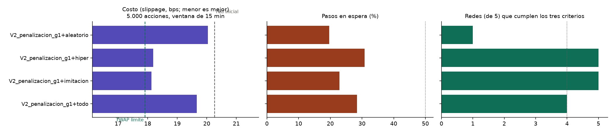

# Experimentos de recompensa, etapa B

**Elaborado por:** PS con apoyo de Claude Code (uso autorizado por la universidad). **Pendiente de revisión por:** BF (R_E) y MR (entrenamiento). Simulador de Poisson en el PC; 1.000 episodios por red y 5 semillas de red por variante; evaluación con 50 semillas nuevas.

Criterio para dar por buena una red (escenario de 5.000 acciones, política muestreada): (1) cumple la orden por su cuenta (≥ 90 % voluntario), (2) no se queda esperando (≤ 50 % de los pasos) y (3) cuesta menos que su propia red inicial (Wilcoxon pareado, p < 0,05). Una variante funciona si 4 de 5 redes lo cumplen.

## 1. Qué cambia en cada variante

| Variante | Qué cambia |
|---|---|
| V2_penalizacion_g1+aleatorio | recompensa original, penalización 30 bps por acción pendiente, tamaño y ventana aleatorios |
| V2_penalizacion_g1+hiper | recompensa original, penalización 30 bps por acción pendiente |
| V2_penalizacion_g1+imitacion | recompensa original, penalización 30 bps por acción pendiente |
| V2_penalizacion_g1+todo | recompensa original, penalización 30 bps por acción pendiente, tamaño y ventana aleatorios |

## 2. Resultado por escenario (promedio de las 5 redes, política muestreada)

### 1.000 acciones, 15 min

| Variante | Slippage (bps) | Red inicial (bps) | Cumplimiento voluntario | Pasos en espera |
|---|---:|---:|---:|---:|
| V2_penalizacion_g1+aleatorio | 17,69 | 17,87 | 1,00 | 19 % |
| V2_penalizacion_g1+hiper | 17,74 | 17,87 | 1,00 | 31 % |
| V2_penalizacion_g1+imitacion | 17,98 | 17,87 | 1,00 | 23 % |
| V2_penalizacion_g1+todo | 17,85 | 17,87 | 1,00 | 29 % |
| *Referencia: TWAP con órdenes límite* | 17,90 | — | 0,98 | 0 % |
| *Referencia: mercado agresiva* | 18,27 | — | 1,00 | 0 % |
| *Referencia: esperar siempre* | 18,96 | — | 0,00 | 100 % |

### 5.000 acciones, 15 min

| Variante | Slippage (bps) | Red inicial (bps) | Cumplimiento voluntario | Pasos en espera |
|---|---:|---:|---:|---:|
| V2_penalizacion_g1+aleatorio | 20,04 | 20,26 | 1,00 | 20 % |
| V2_penalizacion_g1+hiper | 18,18 | 20,26 | 1,00 | 31 % |
| V2_penalizacion_g1+imitacion | 18,13 | 20,26 | 1,00 | 23 % |
| V2_penalizacion_g1+todo | 19,66 | 20,26 | 1,00 | 28 % |
| *Referencia: TWAP con órdenes límite* | 17,91 | — | 0,98 | 0 % |
| *Referencia: mercado agresiva* | 20,93 | — | 1,00 | 0 % |
| *Referencia: esperar siempre* | 21,53 | — | 0,00 | 100 % |

### 20.000 acciones, 15 min

| Variante | Slippage (bps) | Red inicial (bps) | Cumplimiento voluntario | Pasos en espera |
|---|---:|---:|---:|---:|
| V2_penalizacion_g1+aleatorio | 21,10 | 21,13 | 1,00 | 19 % |
| V2_penalizacion_g1+hiper | 20,57 | 21,13 | 0,99 | 31 % |
| V2_penalizacion_g1+imitacion | 20,57 | 21,13 | 0,98 | 22 % |
| V2_penalizacion_g1+todo | 21,00 | 21,13 | 0,98 | 29 % |
| *Referencia: TWAP con órdenes límite* | 19,31 | — | 0,96 | 0 % |
| *Referencia: mercado agresiva* | 21,45 | — | 1,00 | 0 % |
| *Referencia: esperar siempre* | 21,97 | — | 0,00 | 100 % |

## 3. Criterio por variante

| Variante | Redes que cumplen la orden | Redes que no esperan | Redes que bajan el costo | **Redes que cumplen los tres** | Diferencia media frente a la red inicial (bps) | ¿Funciona? |
|---|---:|---:|---:|---:|---:|:---:|
| V2_penalizacion_g1+aleatorio | 5 de 5 | 5 de 5 | 1 de 5 | **1 de 5** | -0,22 | no |
| V2_penalizacion_g1+hiper | 5 de 5 | 5 de 5 | 5 de 5 | **5 de 5** | -2,08 | sí |
| V2_penalizacion_g1+imitacion | 5 de 5 | 5 de 5 | 5 de 5 | **5 de 5** | -2,13 | sí |
| V2_penalizacion_g1+todo | 5 de 5 | 5 de 5 | 4 de 5 | **4 de 5** | -0,60 | sí |

### Redes que cumplen los tres criterios en cada escenario de evaluación

| Variante | 1.000 acciones | 5.000 acciones | 20.000 acciones |
|---|---:|---:|---:|
| V2_penalizacion_g1+aleatorio | 2 de 5 | 1 de 5 | 1 de 5 |
| V2_penalizacion_g1+hiper | 0 de 5 | 5 de 5 | 5 de 5 |
| V2_penalizacion_g1+imitacion | 0 de 5 | 5 de 5 | 3 de 5 |
| V2_penalizacion_g1+todo | 0 de 5 | 4 de 5 | 2 de 5 |

## 4. Qué pasó durante el entrenamiento (primer y último bloque de 100 episodios)

| Variante | Recompensa | Pasos en espera | Órdenes de mercado | Órdenes límite | Slippage (bps) |
|---|---|---|---|---|---|
| V2_penalizacion_g1+aleatorio | -12,86 → -12,45 | 33 % → 17 % | 33 % → 52 % | 34 % → 31 % | 19,8 → 19,7 |
| V2_penalizacion_g1+hiper | -11,70 → -10,62 | 32 % → 33 % | 35 % → 38 % | 33 % → 30 % | 20,1 → 18,2 |
| V2_penalizacion_g1+imitacion | -11,22 → -10,35 | 8 % → 22 % | 9 % → 12 % | 83 % → 66 % | 19,2 → 18,1 |
| V2_penalizacion_g1+todo | -13,25 → -12,94 | 5 % → 35 % | 5 % → 20 % | 90 % → 45 % | 18,6 → 19,4 |

**Mejor variante según el criterio:** `V2_penalizacion_g1+imitacion` (5 de 5 redes cumplen los tres puntos).

🤖 Generado con [Claude Code](https://claude.com/claude-code)
