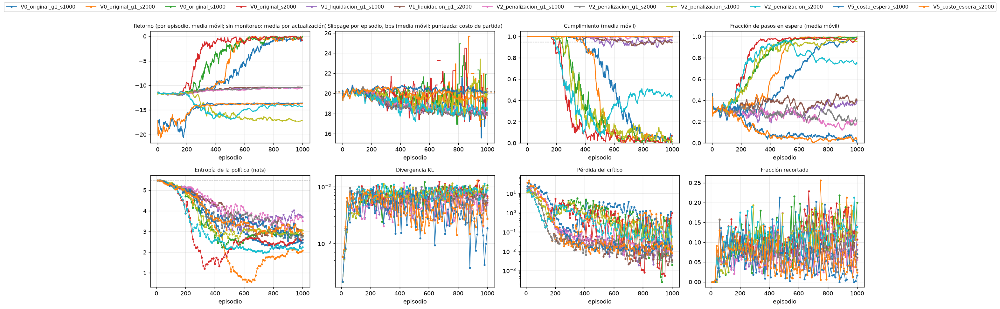

# Monitoreo del entrenamiento (tarea 3.1.4)

**Borrador elaborado por:** PS con apoyo de Claude Code. Panel generado con `scripts/monitorear_entrenamiento.py`.

## Resumen por corrida

| Corrida | Actualizaciones | Episodios registrados | Entropía final (% del máximo) | KL máximo | Cumplimiento final | Pasos en espera (final) | Alertas |
|---|---:|---:|---:|---:|---:|---:|---|
| V0_original_g1_s1000 | 100 | 1000 | 44,9 % | 0,01036 | 0,047 | 98 % | 1 críticas, 3 avisos |
| V0_original_g1_s2000 | 100 | 1000 | 37,9 % | 0,01286 | 0,027 | 99 % | 2 críticas, 3 avisos |
| V0_original_s1000 | 100 | 1000 | 51,6 % | 0,01216 | 0,014 | 99 % | 1 críticas, 3 avisos |
| V0_original_s2000 | 100 | 1000 | 47,4 % | 0,01297 | 0,049 | 96 % | 1 críticas, 3 avisos |
| V1_liquidacion_g1_s1000 | 100 | 1000 | 67,6 % | 0,00965 | 0,962 | 37 % | 0 críticas, 0 avisos |
| V1_liquidacion_g1_s2000 | 100 | 1000 | 50,9 % | 0,00986 | 0,945 | 39 % | 0 críticas, 1 avisos |
| V2_penalizacion_g1_s1000 | 100 | 1000 | 64,0 % | 0,01175 | 0,994 | 19 % | 0 críticas, 0 avisos |
| V2_penalizacion_g1_s2000 | 100 | 1000 | 50,2 % | 0,00983 | 0,996 | 20 % | 0 críticas, 0 avisos |
| V2_penalizacion_s1000 | 100 | 1000 | 55,9 % | 0,01143 | 0,032 | 96 % | 1 críticas, 2 avisos |
| V2_penalizacion_s2000 | 100 | 1000 | 40,9 % | 0,01130 | 0,449 | 76 % | 2 críticas, 2 avisos |
| V5_costo_espera_s1000 | 100 | 1000 | 47,7 % | 0,01060 | 1,000 | 3 % | 0 críticas, 0 avisos |
| V5_costo_espera_s2000 | 100 | 1000 | 53,0 % | 0,00983 | 1,000 | 3 % | 0 críticas, 0 avisos |

## Alertas

**V0_original_g1_s1000**

- **CRITICA** `CUMPLIMIENTO_CRITICO`: Cumplimiento medio 0.047 en los ultimos 50 episodios (< 0.5).
- **AVISO** `ESPERA_ALTA`: La politica espera en el 98 % de los pasos (ultimos 50 episodios).
- **AVISO** `ESPERA_EN_AUMENTO`: La fraccion de pasos en espera subio de 30 % a 98 %: la politica puede estar aprendiendo a no ejecutar (R_E sin costo por esperar).
- **AVISO** `RECOMPENSA_SUBE_COSTO_NO`: El retorno medio mejora 96 % (-11.78 a -0.45) pero el slippage solo baja 1.1 bps (20.2 a 19.1): la red puede estar optimizando la recompensa y no el costo.
- **INFO** `ENTROPIA_BAJA`: Entropia al 46 % del maximo: la politica se esta concentrando; evaluar tambien con muestreo y no solo con argmax.

**V0_original_g1_s2000**

- **CRITICA** `CUMPLIMIENTO_CRITICO`: Cumplimiento medio 0.027 en los ultimos 50 episodios (< 0.5).
- **CRITICA** `ENTROPIA_COLAPSADA`: Entropia al 37 % del maximo: la politica casi no explora.
- **AVISO** `ESPERA_ALTA`: La politica espera en el 99 % de los pasos (ultimos 50 episodios).
- **AVISO** `ESPERA_EN_AUMENTO`: La fraccion de pasos en espera subio de 30 % a 99 %: la politica puede estar aprendiendo a no ejecutar (R_E sin costo por esperar).
- **AVISO** `RECOMPENSA_SUBE_COSTO_NO`: El retorno medio mejora 97 % (-11.66 a -0.34) pero el slippage solo baja 0.3 bps (20.0 a 19.7): la red puede estar optimizando la recompensa y no el costo.

**V0_original_s1000**

- **CRITICA** `CUMPLIMIENTO_CRITICO`: Cumplimiento medio 0.014 en los ultimos 50 episodios (< 0.5).
- **AVISO** `ESPERA_ALTA`: La politica espera en el 99 % de los pasos (ultimos 50 episodios).
- **AVISO** `ESPERA_EN_AUMENTO`: La fraccion de pasos en espera subio de 30 % a 99 %: la politica puede estar aprendiendo a no ejecutar (R_E sin costo por esperar).
- **AVISO** `RECOMPENSA_SUBE_COSTO_NO`: El retorno medio mejora 98 % (-11.75 a -0.24) pero el slippage solo baja -0.0 bps (20.2 a 20.2): la red puede estar optimizando la recompensa y no el costo.
- **INFO** `ENTROPIA_BAJA`: Entropia al 52 % del maximo: la politica se esta concentrando; evaluar tambien con muestreo y no solo con argmax.

**V0_original_s2000**

- **CRITICA** `CUMPLIMIENTO_CRITICO`: Cumplimiento medio 0.049 en los ultimos 50 episodios (< 0.5).
- **AVISO** `ESPERA_ALTA`: La politica espera en el 96 % de los pasos (ultimos 50 episodios).
- **AVISO** `ESPERA_EN_AUMENTO`: La fraccion de pasos en espera subio de 30 % a 96 %: la politica puede estar aprendiendo a no ejecutar (R_E sin costo por esperar).
- **AVISO** `RECOMPENSA_SUBE_COSTO_NO`: El retorno medio mejora 97 % (-11.63 a -0.31) pero el slippage solo baja 0.1 bps (20.0 a 19.9): la red puede estar optimizando la recompensa y no el costo.
- **INFO** `ENTROPIA_BAJA`: Entropia al 48 % del maximo: la politica se esta concentrando; evaluar tambien con muestreo y no solo con argmax.

**V1_liquidacion_g1_s1000**

- **INFO** `ENTROPIA_BAJA`: Entropia al 69 % del maximo: la politica se esta concentrando; evaluar tambien con muestreo y no solo con argmax.

**V1_liquidacion_g1_s2000**

- **AVISO** `CUMPLIMIENTO_BAJO`: Cumplimiento medio 0.945 en los ultimos 50 episodios (< 0.95): regla de vigilancia de D3.
- **INFO** `ENTROPIA_BAJA`: Entropia al 55 % del maximo: la politica se esta concentrando; evaluar tambien con muestreo y no solo con argmax.

**V2_penalizacion_g1_s1000**

- **INFO** `ENTROPIA_BAJA`: Entropia al 67 % del maximo: la politica se esta concentrando; evaluar tambien con muestreo y no solo con argmax.

**V2_penalizacion_g1_s2000**

- **INFO** `ENTROPIA_BAJA`: Entropia al 50 % del maximo: la politica se esta concentrando; evaluar tambien con muestreo y no solo con argmax.

**V2_penalizacion_s1000**

- **CRITICA** `CUMPLIMIENTO_CRITICO`: Cumplimiento medio 0.032 en los ultimos 50 episodios (< 0.5).
- **AVISO** `ESPERA_ALTA`: La politica espera en el 96 % de los pasos (ultimos 50 episodios).
- **AVISO** `ESPERA_EN_AUMENTO`: La fraccion de pasos en espera subio de 30 % a 96 %: la politica puede estar aprendiendo a no ejecutar (R_E sin costo por esperar).
- **INFO** `SIN_MEJORA`: El retorno medio no mejora: -11.73 (primeros 50) frente a -17.23 (ultimos 50).
- **INFO** `ENTROPIA_BAJA`: Entropia al 55 % del maximo: la politica se esta concentrando; evaluar tambien con muestreo y no solo con argmax.

**V2_penalizacion_s2000**

- **CRITICA** `CUMPLIMIENTO_CRITICO`: Cumplimiento medio 0.449 en los ultimos 50 episodios (< 0.5).
- **CRITICA** `ENTROPIA_COLAPSADA`: Entropia al 40 % del maximo: la politica casi no explora.
- **AVISO** `ESPERA_ALTA`: La politica espera en el 76 % de los pasos (ultimos 50 episodios).
- **AVISO** `ESPERA_EN_AUMENTO`: La fraccion de pasos en espera subio de 30 % a 76 %: la politica puede estar aprendiendo a no ejecutar (R_E sin costo por esperar).
- **INFO** `SIN_MEJORA`: El retorno medio no mejora: -11.62 (primeros 50) frente a -14.24 (ultimos 50).

**V5_costo_espera_s1000**

- **INFO** `ENTROPIA_BAJA`: Entropia al 47 % del maximo: la politica se esta concentrando; evaluar tambien con muestreo y no solo con argmax.
- **INFO** `PICO_PERDIDA_CRITICO`: Pico de la perdida del critico (35.7, mediana 0.02).

**V5_costo_espera_s2000**

- **INFO** `ENTROPIA_BAJA`: Entropia al 55 % del maximo: la politica se esta concentrando; evaluar tambien con muestreo y no solo con argmax.
- **INFO** `PICO_PERDIDA_CRITICO`: Pico de la perdida del critico (47.8, mediana 0.02).

## Cómo leerlo

- **Entropía:** una política uniforme sobre las 240 acciones tiene 5,48 nats. Una caída fuerte significa que la política se concentra; conviene evaluar también con muestreo y no solo con argmax (ver `docs/entrenamiento_inicial_2.3.5.md`).
- **Pasos en espera:** acciones `LIMIT_SELL`, que el puente de ABIDES y el simulador Poisson tratan como «esperar».
- Sin el CSV de monitoreo por episodio solo se muestran las curvas del entrenador; el costo y el cumplimiento por episodio se registran con `MonitorEntrenamiento` (`src/training/monitoreo.py`).

🤖 Generado con [Claude Code](https://claude.com/claude-code)
