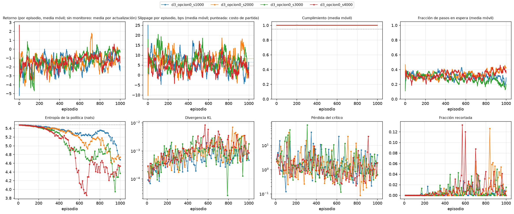

# Monitoreo del entrenamiento (tarea 3.1.4)

**Borrador elaborado por:** PS con apoyo de Claude Code. Panel generado con `scripts/monitorear_entrenamiento.py`.

## Resumen por corrida

| Corrida | Actualizaciones | Episodios registrados | Entropía final (% del máximo) | KL máximo | Cumplimiento final | Pasos en espera (final) | Alertas |
|---|---:|---:|---:|---:|---:|---:|---|
| d3_opcion0_s1000 | 100 | 1000 | 85,4 % | 0,00214 | 1,000 | 27 % | 0 críticas, 0 avisos |
| d3_opcion0_s2000 | 100 | 1000 | 86,5 % | 0,00700 | 1,000 | 42 % | 1 críticas, 1 avisos |
| d3_opcion0_s3000 | 100 | 1000 | 79,7 % | 0,00325 | 1,000 | 20 % | 0 críticas, 1 avisos |
| d3_opcion0_s4000 | 100 | 1000 | 82,7 % | 0,00841 | 1,000 | 39 % | 0 críticas, 0 avisos |

## Alertas

**d3_opcion0_s1000**

- **INFO** `ENTROPIA_BAJA`: Entropia al 88 % del maximo: la politica se esta concentrando; evaluar tambien con muestreo y no solo con argmax.

**d3_opcion0_s2000**

- **CRITICA** `ARGMAX_DISTINTO_DE_MUESTREO`: Cumplimiento 0.000 con argmax y 0.999 muestreando: la evaluacion determinista no representa la politica entrenada.
- **AVISO** `RECOMPENSA_SUBE_COSTO_NO`: El retorno medio mejora 49 % (-1.77 a -0.89) pero el slippage solo baja 0.6 bps (8.3 a 7.7): la red puede estar optimizando la recompensa y no el costo.
- **INFO** `ENTROPIA_BAJA`: Entropia al 86 % del maximo: la politica se esta concentrando; evaluar tambien con muestreo y no solo con argmax.

**d3_opcion0_s3000**

- **AVISO** `RECOMPENSA_SUBE_COSTO_NO`: El retorno medio mejora 78 % (-1.66 a -0.37) pero el slippage solo baja 1.3 bps (8.2 a 6.9): la red puede estar optimizando la recompensa y no el costo.
- **INFO** `ENTROPIA_BAJA`: Entropia al 80 % del maximo: la politica se esta concentrando; evaluar tambien con muestreo y no solo con argmax.

**d3_opcion0_s4000**

- **INFO** `ENTROPIA_BAJA`: Entropia al 82 % del maximo: la politica se esta concentrando; evaluar tambien con muestreo y no solo con argmax.

## Cómo leerlo

- **Entropía:** una política uniforme sobre las 240 acciones tiene 5,48 nats. Una caída fuerte significa que la política se concentra; conviene evaluar también con muestreo y no solo con argmax (ver `docs/entrenamiento_inicial_2.3.5.md`).
- **Pasos en espera:** acciones `LIMIT_SELL`, que el puente de ABIDES y el simulador Poisson tratan como «esperar».
- Sin el CSV de monitoreo por episodio solo se muestran las curvas del entrenador; el costo y el cumplimiento por episodio se registran con `MonitorEntrenamiento` (`src/training/monitoreo.py`).

🤖 Generado con [Claude Code](https://claude.com/claude-code)
