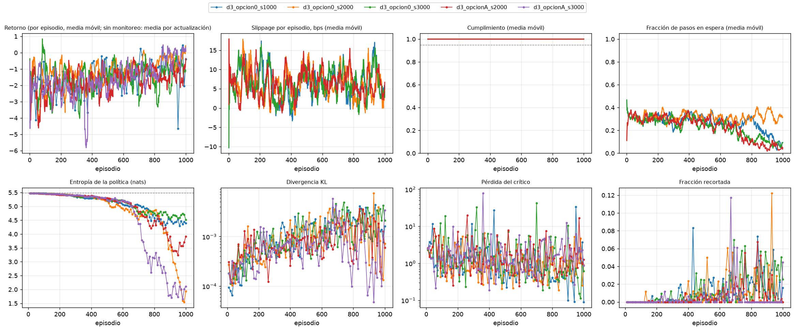

# Monitoreo del entrenamiento (tarea 3.1.4)

**Borrador elaborado por:** PS con apoyo de Claude Code. Panel generado con `scripts/monitorear_entrenamiento.py`.

## Resumen por corrida

| Corrida | Actualizaciones | Episodios registrados | Entropía final (% del máximo) | KL máximo | Cumplimiento final | Pasos en espera (final) | Alertas |
|---|---:|---:|---:|---:|---:|---:|---|
| d3_opcion0_s1000 | 100 | — | 80,1 % | 0,00438 | — | — | 1 críticas, 1 avisos |
| d3_opcion0_s2000 | 100 | 1000 | 35,3 % | 0,00753 | 1,000 | 8 % | 1 críticas, 0 avisos |
| d3_opcion0_s3000 | 100 | 1000 | 82,4 % | 0,00489 | 1,000 | 32 % | 0 críticas, 1 avisos |
| d3_opcionA_s2000 | 100 | 1000 | 71,4 % | 0,00363 | 1,000 | 8 % | 0 críticas, 1 avisos |
| d3_opcionA_s3000 | 100 | 1000 | 38,6 % | 0,00584 | 1,000 | 4 % | 1 críticas, 0 avisos |

## Alertas

**d3_opcion0_s1000**

- **CRITICA** `ARGMAX_DISTINTO_DE_MUESTREO`: Cumplimiento 0.000 con argmax y 1.000 muestreando: la evaluacion determinista no representa la politica entrenada.
- **AVISO** `ENTROPIA_BAJA`: Entropia al 80 % del maximo: la politica se esta concentrando; evaluar tambien con muestreo y no solo con argmax.
- **INFO** `PICO_PERDIDA_CRITICO`: Pico de la perdida del critico (33.3, mediana 0.86).

**d3_opcion0_s2000**

- **CRITICA** `ENTROPIA_COLAPSADA`: Entropia al 34 % del maximo: la politica casi no explora.

**d3_opcion0_s3000**

- **AVISO** `ENTROPIA_BAJA`: Entropia al 85 % del maximo: la politica se esta concentrando; evaluar tambien con muestreo y no solo con argmax.
- **INFO** `PICO_PERDIDA_CRITICO`: Pico de la perdida del critico (42.1, mediana 1.12).

**d3_opcionA_s2000**

- **AVISO** `ENTROPIA_BAJA`: Entropia al 67 % del maximo: la politica se esta concentrando; evaluar tambien con muestreo y no solo con argmax.

**d3_opcionA_s3000**

- **CRITICA** `ENTROPIA_COLAPSADA`: Entropia al 36 % del maximo: la politica casi no explora.
- **INFO** `PICO_PERDIDA_CRITICO`: Pico de la perdida del critico (79.1, mediana 1.36).

## Cómo leerlo

- **Entropía:** una política uniforme sobre las 240 acciones tiene 5,48 nats. Una caída fuerte significa que la política se concentra; conviene evaluar también con muestreo y no solo con argmax (ver `docs/entrenamiento_inicial_2.3.5.md`).
- **Pasos en espera:** acciones `LIMIT_SELL`, que el puente de ABIDES y el simulador Poisson tratan como «esperar».
- Sin el CSV de monitoreo por episodio solo se muestran las curvas del entrenador; el costo y el cumplimiento por episodio se registran con `MonitorEntrenamiento` (`src/training/monitoreo.py`).

🤖 Generado con [Claude Code](https://claude.com/claude-code)
