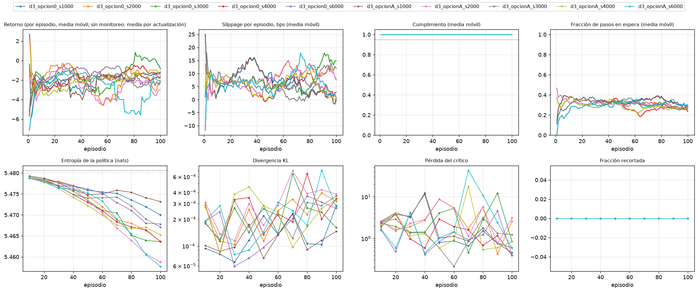

# Monitoreo del entrenamiento (tarea 3.1.4)

**Borrador elaborado por:** PS con apoyo de Claude Code. Panel generado con `scripts/monitorear_entrenamiento.py`.

## Resumen por corrida

| Corrida | Actualizaciones | Episodios registrados | Entropía final (% del máximo) | KL máximo | Cumplimiento final | Pasos en espera (final) | Alertas |
|---|---:|---:|---:|---:|---:|---:|---|
| d3_opcion0_s1000 | 10 | 100 | 99,8 % | 0,00028 | 1,000 | 34 % | 0 críticas, 0 avisos |
| d3_opcion0_s2000 | 10 | 100 | 99,7 % | 0,00039 | 1,000 | 29 % | 0 críticas, 0 avisos |
| d3_opcion0_s3000 | 10 | 100 | 99,7 % | 0,00064 | 1,000 | 27 % | 0 críticas, 0 avisos |
| d3_opcion0_s4000 | 10 | 100 | 99,7 % | 0,00065 | 1,000 | 25 % | 1 críticas, 0 avisos |
| d3_opcion0_s6000 | 10 | 100 | 99,8 % | 0,00036 | 1,000 | 31 % | 0 críticas, 0 avisos |
| d3_opcionA_s1000 | 10 | 100 | 99,9 % | 0,00023 | 1,000 | 34 % | 0 críticas, 0 avisos |
| d3_opcionA_s2000 | 10 | 100 | 99,6 % | 0,00070 | 1,000 | 29 % | 1 críticas, 0 avisos |
| d3_opcionA_s3000 | 10 | 100 | 99,8 % | 0,00036 | 1,000 | 29 % | 0 críticas, 0 avisos |
| d3_opcionA_s4000 | 10 | 100 | 99,7 % | 0,00046 | 1,000 | 28 % | 0 críticas, 0 avisos |
| d3_opcionA_s6000 | 10 | 100 | 99,6 % | 0,00071 | 1,000 | 31 % | 0 críticas, 0 avisos |

## Alertas

**d3_opcion0_s1000**

- Sin alertas.

**d3_opcion0_s2000**

- **INFO** `SIN_MEJORA`: El retorno medio no mejora: -1.82 (primeros 50) frente a -2.27 (ultimos 50).

**d3_opcion0_s3000**

- Sin alertas.

**d3_opcion0_s4000**

- **CRITICA** `ARGMAX_DISTINTO_DE_MUESTREO`: Cumplimiento 0.646 con argmax y 1.000 muestreando: la evaluacion determinista no representa la politica entrenada.

**d3_opcion0_s6000**

- **INFO** `SIN_MEJORA`: El retorno medio no mejora: -1.20 (primeros 50) frente a -1.87 (ultimos 50).

**d3_opcionA_s1000**

- Sin alertas.

**d3_opcionA_s2000**

- **CRITICA** `ARGMAX_DISTINTO_DE_MUESTREO`: Cumplimiento 0.115 con argmax y 1.000 muestreando: la evaluacion determinista no representa la politica entrenada.
- **INFO** `SIN_MEJORA`: El retorno medio no mejora: -2.36 (primeros 50) frente a -2.88 (ultimos 50).

**d3_opcionA_s3000**

- **INFO** `SIN_MEJORA`: El retorno medio no mejora: -1.94 (primeros 50) frente a -1.97 (ultimos 50).

**d3_opcionA_s4000**

- Sin alertas.

**d3_opcionA_s6000**

- **INFO** `SIN_MEJORA`: El retorno medio no mejora: -1.75 (primeros 50) frente a -3.51 (ultimos 50).
- **INFO** `PICO_PERDIDA_CRITICO`: Pico de la perdida del critico (42.9, mediana 1.56).

## Cómo leerlo

- **Entropía:** una política uniforme sobre las 240 acciones tiene 5,48 nats. Una caída fuerte significa que la política se concentra; conviene evaluar también con muestreo y no solo con argmax (ver `docs/entrenamiento_inicial_2.3.5.md`).
- **Pasos en espera:** acciones `LIMIT_SELL`, que el puente de ABIDES y el simulador Poisson tratan como «esperar».
- Sin el CSV de monitoreo por episodio solo se muestran las curvas del entrenador; el costo y el cumplimiento por episodio se registran con `MonitorEntrenamiento` (`src/training/monitoreo.py`).

🤖 Generado con [Claude Code](https://claude.com/claude-code)
